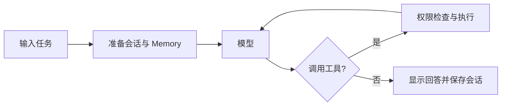

# Toy SWE Agent

用于学习与实验的终端编程助手：对话、文件与 Shell 工具、会话恢复、Memory、子代理和 Agent Teams。

## 快速开始

需要 Python ≥ 3.13，推荐使用 [uv](https://docs.astral.sh/uv/)。

```bash
uv sync
uv run python main.py
```

在程序中配置密钥、选择模型，再输入任务：

```text
/keys add
/model
请分析当前项目，并告诉我如何运行测试
```

`/model` 同时支持输入文字模糊搜索和 ↑↓ 选择；Enter 确认、Esc 取消、Ctrl+U 清空搜索。长列表支持 PgUp/PgDn、Home/End。

任务运行中（包括 Preparing／Thinking）第一次按 Esc 显示中止提示，第二次按 Esc 停止当前轮；Ctrl+C 立即停止。会话与已有改动保留，回到输入框后可输入“继续”。这不是冻结远端请求，停止后迟到的模型结果会被丢弃。审批窗口里的 Esc 仍直接停止。

> 默认 `sandbox` 模式：Linux 需要 bubblewrap；macOS 使用 sandbox-exec。Windows 原生环境没有沙箱后端，缺少后端时拒绝执行，不自动回退。

无需安装沙箱组件时，可显式启用宿主模式：

```bash
uv run python main.py --execution-mode host
```

已在外部目标目录的 PowerShell 中，可直接运行：

```powershell
& "D:\CodePy\swe-agent\.venv\Scripts\python.exe" "D:\CodePy\swe-agent\main.py" --execution-mode host
```

`host` 使用 Windows PowerShell／pwsh（其他平台为 sh），每条 Shell 命令单次审批，无 OS 文件／网络隔离。用 `/status` 查看模式；Windows 的 curl 示例使用 `curl.exe --head https://example.com`。启动目录仍是 workspace，但不能阻止命令访问其他目录。

## 常用命令

| 命令 | 用途 |
| --- | --- |
| `/help` | 查看命令 |
| `/model` | 搜索并选择服务商、模型 |
| `/keys` | 查看密钥；[完整操作](docs/KEYS.md) |
| `/permissions` | 处理待审批请求；[审批说明](docs/PERMISSIONS.md) |
| `/status` | 查看模型、目录、会话和 checkpoint |
| `/new [title]` | 新建会话 |
| `/sessions [limit]` | 列出历史会话 |
| `/resume <session-id>` | 恢复会话；不恢复权限授权 |
| `/clear` | 清空当前历史、工具状态和 checkpoint 状态 |
| `/compact` | 将上下文压缩为摘要，保留原始 transcript |
| `/memory [on\|off\|status]` | 控制当前会话 Memory |
| `/team` | 启动、审批、查看或停止团队；[团队操作](docs/TEAMS.md) |
| `/debug` | 查看格式化历史 |
| `/experiment [on [path]\|off\|status]` | 开启、关闭或查看实验日志；默认写入 `.swe-agent/experiments/` |

## 一次任务如何运行



| 能力 | 使用方式 |
| --- | --- |
| 文件与 Shell | 用自然语言提出任务；需要额外权限时审批 |
| Memory | 默认开启；本地检索先用，后台精筛结果供后续请求使用 |
| 上下文回退 | 模型调用 `rewind_context`；保留结论，不撤销实际操作 |
| Skill | 放入 `.agents/skills/<name>/SKILL.md`，启动扫描、按需加载 |
| 子代理 | 模型通过 `delegate_task` 委派独立上下文的任务 |

## 配置与数据

内置服务商如下；启动默认使用 SiliconFlow。模型以 `/model` 实际获取的列表为准。

| 服务商 ID | API 地址 | 环境变量 |
| --- | --- | --- |
| `siliconflow` | `https://api.siliconflow.cn/v1` | `SILICONFLOW_API_KEY` |
| `openai` | `https://api.openai.com/v1` | `OPENAI_API_KEY` |
| `opencode-go` | `https://opencode.ai/zen/go/v1` | `OPENCODE_GO_API_KEY` |

凭据优先级：**数据库默认密钥 → 环境变量 → 无密钥**。密钥通过隐藏输入获取，请勿放入命令参数。

| 位置 | 内容 |
| --- | --- |
| `~/.swe-agent/state.db` | 服务商、模型、密钥、验证记录和会话 |
| `SWE_AGENT_DB_PATH` | 覆盖数据库路径的环境变量 |
| `<workspace>/.swe-agent/` | Memory、任务、团队、checkpoint、分支与压缩记录 |

状态库包含 API Key，请勿提交到 Git。项目目前用于实验，Shell 沙箱允许修改 workspace；重要改动请使用 Git 保留恢复点。

## 开发与文档

```bash
uv run pytest
```

| 入口 | 内容 |
| --- | --- |
| [架构概览](docs/ARCHITECTURE.md) | 模块、运行流程、状态边界与扩展 |
| [密钥管理](docs/KEYS.md) | list / add / use / test / remove / source / reset |
| [权限审批](docs/PERMISSIONS.md) | 审批选择、授权范围和后台操作 |
| [团队操作](docs/TEAMS.md) | 计划审批、任务与 worktree |
| [人工测试](docs/permission-manual-tests.md) | 权限功能验收步骤 |

主要代码：`main.py`（装配）、`src/runtime/`（运行时）、`src/tools/`（工具）、`src/infrastructure/`（存储与客户端）、`src/ui/`（终端）、`src/teams/`（团队）。

## License

MIT
