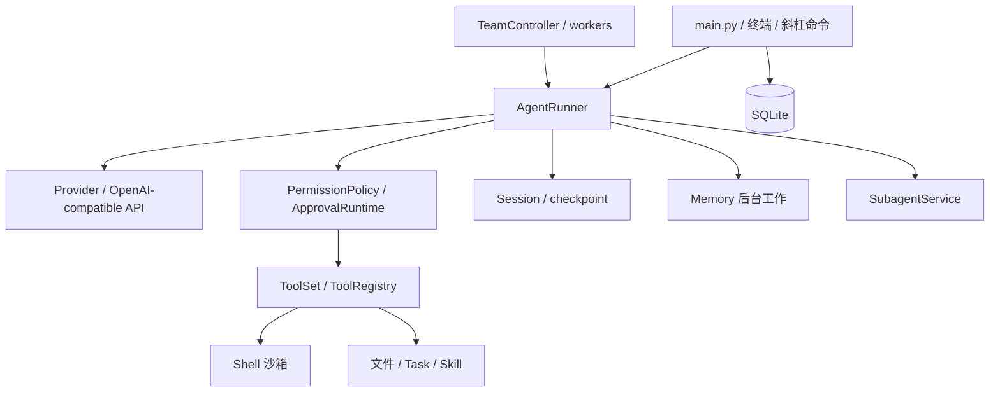
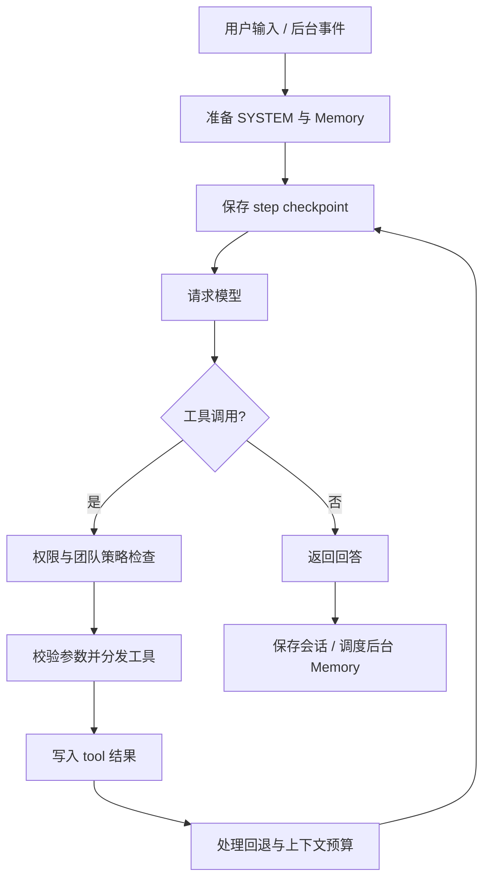
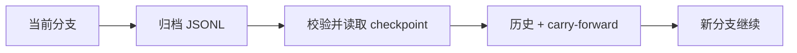
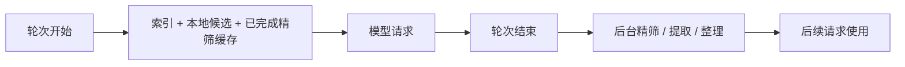

# 架构概览

## 模块关系



| 目录／模块 | 职责 |
| --- | --- |
| `main.py` | 创建 Provider、数据库、工具、Runner 与终端命令 |
| `src/runtime/` | Agent Loop、Session、审批、沙箱、回退和后台 Memory |
| `src/infrastructure/` | 数据库、凭据解析、Provider、持久化、压缩与 Memory |
| `src/tools/` | 文件、Shell、任务、Skill、上下文回退与子代理工具 |
| `src/teams/` | 团队计划、任务板、消息与 worktree |
| `src/ui/` | 终端渲染、动画、搜索选择菜单 |
| `src/utils/slash_commands/` | 用户命令与补全 |
| `src/prompts/` | 主 Agent、子代理及提醒提示词 |

## Agent Loop



- Runner 负责模型与工具消息配对；被跳过的工具也有结果消息。
- 拒绝可让模型重新规划；停止结束运行。详见 [权限审批](PERMISSIONS.md)。
- `Preparing` 表示本地准备，`Thinking` 表示模型请求；非 TTY 不输出动画控制字符。
- 前台模型请求在独立线程等待，主线程轮询取消状态；第一次 Esc 提示、第二次 Esc 停止，Ctrl+C 立即停止。迟到结果不写入历史、不执行工具；远端请求可能仍在处理。
- Windows 使用控制台按键监听，POSIX 使用终端监听与信号；审批提示读键时持有输入锁，监听线程让出终端。

## Provider 与凭据

```text
ProviderProfile + CredentialService → Provider.client
Session.provider_id / model        → 本次请求的服务商与模型
AppDatabase                        → 配置、密钥与验证记录
```

| 操作 | 行为 |
| --- | --- |
| 启动 | 读取数据库默认密钥，否则读取环境变量；不复制环境变量到数据库 |
| `/model` | 获取清单，模糊搜索与菜单选择，只读取凭据 |
| `/keys` | 管理命名密钥、默认项、来源及验证 |
| 模型请求重试 | 429／529 最多重试 3 次，使用 Retry-After 或退避 |
| 密钥／模型列表验证 | 15 秒超时、无自动重试、错误脱敏 |

详见 [密钥与模型](KEYS.md)。SQLite schema 由 `AppDatabase` 迁移，当前版本为 6。

## 状态与持久化

| 状态 | 保存位置 | 恢复边界 |
| --- | --- | --- |
| 服务商、模型、凭据、验证记录 | SQLite | 保留配置 |
| 会话历史、工具状态、Memory 开关、checkpoint 元数据 | SQLite | `/resume` 恢复 |
| 权限授权、待审批请求 | 进程内存 | 不跨卸载／恢复／重启保留授权 |
| checkpoint／废弃上下文分支 | `.swe-agent/context/` | 文件保留，配合会话元数据使用 |
| Memory | `.swe-agent/memory/` | 按项目和可见范围读取 |
| 压缩 transcript／工具结果归档 | `.swe-agent/transcripts/`、`.swe-agent/tool-results/` | 留档查询 |
| 普通任务／后台任务 | `.swe-agent/tasks/`、`.swe-agent/background_tasks/` | 保存任务状态；后台 handler 不自动重启 |
| 团队状态／任务／消息 | `.swe-agent/teams/` | 重新启动同一团队可恢复；worker Session 不恢复 |

数据库默认 `~/.swe-agent/state.db`，可用 `SWE_AGENT_DB_PATH` 覆盖。

## 三种上下文管理

| 功能 | 触发 | 结果 |
| --- | --- | --- |
| 自动压缩 | 上下文预算管理 | 截断／归档工具结果，压缩旧结果并裁剪消息 |
| `/compact` | 用户命令 | 保存原始 transcript，以模型摘要替换历史 |
| `rewind_context` | 模型独立工具调用 | 恢复 checkpoint，创建新分支并带入结构化结论 |



回退只改变模型工作记忆。文件、Shell／网络副作用、审批、任务与团队事件保留。每个 Agent 只能回退自己的 Session；回退会使旧 Memory 后台任务的 generation 失效。长期记忆候选仍需提取器复核。

## Memory



默认开启；`/memory off` 后不注入、不抽取。后台工作不直接并发修改对话历史。

## 扩展工具与 Skill

| 扩展 | 最小步骤 | 约束 |
| --- | --- | --- |
| Tool | 继承 `BaseTool`，定义 name／description／args_model／run，再注册到 ToolSet | 参数由 Pydantic 校验；通过 Runner 执行权限检查 |
| 工具视图 | `toolset.view(exclude=...)` | 共享注册表，仅暴露允许工具 |
| 后台 handler | `background_task_manager.register_handler(name, callable)` | 默认不含业务 handler；payload 必须可 JSON 序列化 |
| Skill | 创建下方 SKILL.md，重启扫描 | SYSTEM 只放简介；`load_skill` 返回正文 |

```text
.agents/skills/example/SKILL.md
```

```markdown
---
name: example
description: 何时使用此 Skill
---
具体操作步骤。
```

`ToolContext` 携带 Session、workspace、Agent／Task、审批来源和批准能力。新增文件工具须自行验证 workspace 边界；未知工具默认需审批。

## 子代理、后台任务与团队

| 方式 | 用途 | 执行与边界 |
| --- | --- | --- |
| Subagent | 同步委派独立分析／实现任务 | 独立 Session；共享 workspace 的实际副作用保留 |
| 普通 Task | 任务描述、依赖与状态 | 元数据管理，不执行任务正文 |
| Background task | 已注册的耗时 handler | 线程池执行；终态事件在下一次 Runner 请求前注入 |
| Agent Teams | Lead 规划、多个 worker 协作 | 计划先审批，任务领取后执行；支持 task worktree |

后台任务只可取消 pending 项；in_progress 不强制中止。完成事件使用 event_id 去重；宿主负责唤醒 Session，任务模块不提供全局调度器。普通 JSON 任务存储不提供跨进程事务；Team 任务板另有文件锁与 claim 租约。

团队使用与恢复见 [Agent Teams](TEAMS.md)。

## 验证入口与限制

```bash
uv run pytest
```

测试按 `tests/test_*.py` 覆盖凭据、命令、审批、沙箱、会话、回退、Memory、任务与团队。

- Shell 集成测试需要可用 OS 沙箱，受限环境可能跳过。
- Windows 存在进程组 API 和 worktree 长路径限制。
- Shell 沙箱不回滚文件；worktree 不自动合并。
- checkpoint／branch 文件尚无配额和自动清理。

本页描述已实现行为；操作细节分别维护在密钥、权限和团队文档中。
