# SWE Agent Architecture

本文档记录当前系统中已经实现的关键架构设计，重点说明运行时各模块之间的协作、状态边界、失败行为和扩展约束。

## Provider 与可靠性

Provider 层负责把供应商配置和凭据转换为 OpenAI-compatible 客户端。模型选择属于 Session，配置持久化属于 `AppDatabase`，请求重试属于独立的 `retry` 模块；`Provider` 本身保持为薄封装。

核心实现位于：

- `src/infrastructure/model_provider.py`：创建模型客户端和列出模型。
- `src/infrastructure/database.py`：Provider、Model、Credential 配置及数据库迁移。
- `src/infrastructure/retry.py`：模型请求的统一重试策略。
- `src/utils/slash_commands/commands/model.py`：当前 Session 的模型切换。
- `main.py`：启动时的配置装配和失败处理。

### 配置对象的职责

系统使用三个不可变数据对象描述模型配置：

```python
ProviderProfile(
    id="siliconflow",
    name="SiliconFlow",
    base_url="https://api.siliconflow.cn/v1",
    api_key_env="SILICONFLOW_API_KEY",
)

ModelProfile(
    id="siliconflow-default",
    provider_id="siliconflow",
    model_id="deepseek-ai/DeepSeek-V4-Flash",
    config={},
    is_default=True,
)

ProviderCredential(
    id="siliconflow-default",
    provider_id="siliconflow",
    name="default",
    access_token="...",
    is_default=True,
    is_active=True,
)
```

它们的关系为：

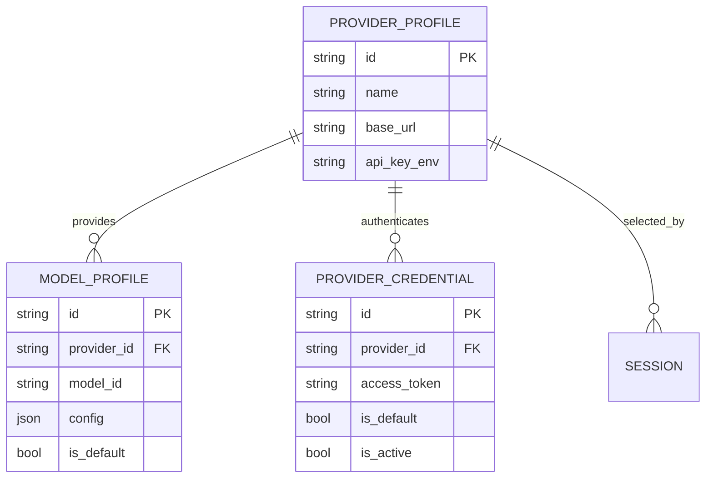

- `ProviderProfile` 描述 API 端点和凭据环境变量，不持有客户端。
- `ModelProfile` 描述某个 Provider 可用的模型及默认选择。
- `ProviderCredential` 描述认证材料及选择状态。
- `Session.model` 和 `Session.provider_id` 记录某次逻辑对话实际使用的组合。

数据库结构支持多个 Provider、多个模型和多份凭据，但当前 `main.py` 在启动时固定装配 SiliconFlow 和一个默认模型，尚未提供完整的多 Provider 选择界面。

### 启动装配流程

应用启动时按以下顺序装配 Provider：

1. 打开 `AppDatabase`，执行 schema 迁移。
2. upsert 当前内置的 `ProviderProfile` 和默认 `ModelProfile`。
3. 从数据库选择该 Provider 的默认或最近更新模型。
4. 从数据库选择 active 的默认或最近更新凭据。
5. 如果没有可用凭据，从 `api_key_env` 指定的环境变量读取 token，并写成默认凭据。
6. 如果仍然没有凭据，显示配置错误并退出。
7. 使用 profile、credential 构造 `Provider` 和 OpenAI 客户端。
8. 使用默认模型创建当前 Session。

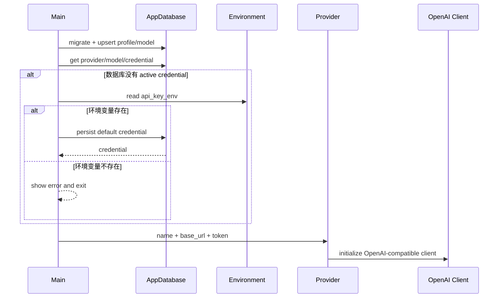

`model_provider.py` 会调用 `load_dotenv()`，因此标准环境变量之外，也可以由运行目录下的 `.env` 提供值。环境变量只在数据库没有 active 凭据时作为回退；数据库已有凭据时，后续修改环境变量不会自动覆盖它。

### Provider 客户端

`Provider` 保存供应商名称、token 和 base URL，并构造 OpenAI SDK 客户端：

```python
if base_url is None:
    OpenAI(api_key=api_key)
else:
    OpenAI(base_url=base_url, api_key=api_key)
```

内置 `PROVIDER_BASE_URLS` 可以按供应商名称补充默认端点。当前没有供应商专用 adapter，所有 Provider 都必须兼容 OpenAI 的 models 和 chat completions API。

`list_model_ids()` 调用远端 models API，对非空模型 ID 去重并排序。`/model` 使用这份列表让用户选择模型，然后只更新并保存当前 `Session.model`：

- 不修改全局 `ModelProfile.is_default`。
- 后续 AgentRunner 请求立即使用新模型。
- Memory 通过 `model_getter` 动态读取当前 Session 模型。
- Subagent 默认继承发起委派的父 Session 模型。

`ModelProfile.config` 当前可以持久化任意 JSON，但尚未合并到 chat completion 请求中；temperature 等配置字段目前只是保留数据。

### 凭据存储和安全边界

`ProviderCredential` 支持 access token、refresh token、过期时间、scope、active 和 default 标志。选择默认凭据时只考虑 `is_active=1`，再按 default 和更新时间排序。

当前实现具有以下安全属性：

- `access_token` 和 `refresh_token` 在 dataclass 的 `repr` 中隐藏，降低日志意外泄漏风险。
- SQLite 文件创建后设置为 `0600`。
- 一个 Provider 通过数据库唯一索引最多只有一份 default credential。
- 设置新默认凭据时，会在同一事务中取消该 Provider 其他凭据的 default 状态。

但 token 当前以明文写入 SQLite，并未使用系统 Keychain 或字段加密。`expires_at`、`refresh_token` 和 `scopes` 也只是持久化元数据，选择凭据时不会检查过期时间，运行时不会自动 refresh。数据库文件权限是目前主要的静态保护边界。

### 数据库迁移和一致性

`AppDatabase` 使用 `PRAGMA user_version` 管理 schema，当前版本为 2：

- v1：Provider、Model、Session、消息和 Session 状态。
- v2：Provider Credential。

打开数据库时：

- 启用 foreign key。
- 设置 5 秒 `busy_timeout`。
- 对文件数据库启用 WAL。
- 拒绝打开版本高于当前代码支持版本的数据库。
- 迁移完成后提交，并确保数据库文件权限为 `0600`。

写操作通过 `transaction()` context manager 执行：正常结束 commit，异常 rollback。该设计适合单机本地状态；它没有字段级加密、跨主机同步或高并发连接池。

### 统一模型请求重试

`request_with_retry()` 包装实际模型请求，目前只重试：

```text
429  rate limit
529  provider overloaded
```

最多重试 3 次，即一次调用总共最多发起 4 次请求。服务端存在 `Retry-After` 时优先使用，支持秒数和 HTTP date，并将等待时间限制在 30 秒以内。没有该 header 时使用指数退避和最多 10% jitter：

```text
1s → 2s → 4s
```

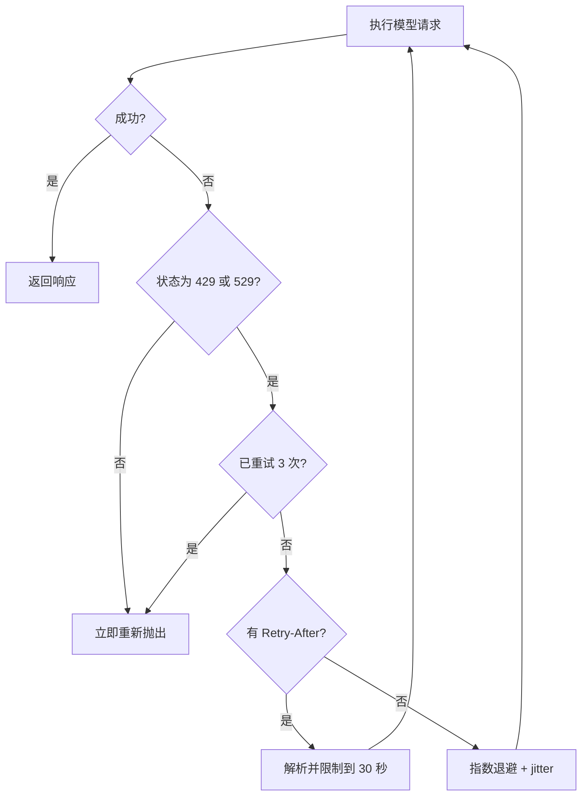

重试是同步等待，会阻塞当前 Runner 或后台 Memory worker 所在线程。连接错误、超时和普通 5xx，包括 500、502、503，当前不会自动重试；现有策略有意保持较窄的可重试状态集合。

### 不同调用点的失败语义

统一重试只解决暂时性请求失败，各调用方仍负责定义最终失败行为：

| 调用点 | 使用统一重试 | 最终失败行为 |
| --- | --- | --- |
| AgentRunner 普通请求 | 是 | 返回 `AgentRunResult(ok=False)` |
| Permission 拒绝总结 | 是 | 返回固定降级说明 |
| Memory side-query / 提取 / 整理 | 是 | 返回空结果；相关 Memory 选择可降级为本地关键词匹配，不中断主循环 |
| `/compact` 摘要 | 是 | 保留原 history 和 transcript，命令层最多尝试 3 次 |
| `/model` 列模型 | 否 | 返回 `Failed to load models from provider` |

模型输出达到 token 上限不属于网络重试，由 AgentRunner 的截断恢复机制处理：先提高 `max_tokens` 重试，再进行有限 continuation。详见“AgentRunner / 输出截断恢复”。

### 当前限制与后续演进

- 主程序仍硬编码单一 Provider 和初始默认模型，多 Provider schema 尚未形成完整产品流程。
- Provider 仅支持 OpenAI-compatible API，没有供应商能力探测或参数适配。
- 数据库凭据是明文，应迁移到操作系统密钥存储或加密 envelope。
- 凭据没有过期校验、refresh 和撤销流程。
- `ModelProfile.config` 尚未进入实际请求参数。
- `/model` 的 models API 请求没有统一重试或本地缓存。
- 重试策略仅覆盖 429/529，且使用同步 sleep；后续可按请求幂等性扩展网络错误和部分 5xx。
- 缺少请求级 timeout、熔断器、Provider 健康状态和可观测指标。

## Tool / Skill 扩展机制

Tool 和 Skill 都向模型提供能力，但职责不同：

| 类型 | 作用 | 进入模型上下文的方式 | 是否直接产生副作用 |
| --- | --- | --- | --- |
| Tool | 执行文件、Shell、任务状态等具体操作 | 以 function schema 暴露，模型通过 tool call 调用 | 可以 |
| Skill | 提供某类任务的知识、规则和工作流说明 | SYSTEM 中先放摘要，正文通过 `load_skill` 工具按需加载 | 不直接产生副作用 |

Skill 可以指导模型组合多个 Tool，但 Skill 本身只是文本。真正的安全和状态边界仍由 Tool、Permission、Session 和运行时负责。

核心实现位于：

- `src/tools/base.py`：Tool 抽象和调用上下文。
- `src/tools/toolset.py`：注册表、schema 暴露、工具视图和分发。
- `src/infrastructure/skill_loader.py`：Skill 发现、frontmatter 解析和两层内容渲染。
- `src/tools/skill/load_skill.py`：把 Skill 正文作为工具结果注入上下文。
- `src/prompts/system.md`：告诉主 Agent 何时加载 Skill。

### Tool 基础协议

每个 Tool 由参数模型和工具类组成：

```python
from typing import Any

from pydantic import BaseModel, Field

from src.tools.base import BaseTool, ToolContext


class SearchArgs(BaseModel):
    query: str = Field(description="Text to search for.")
    limit: int = Field(default=20, ge=1, le=100)


class SearchTool(BaseTool[SearchArgs]):
    name = "search"
    description = "Search the project index."
    args_model = SearchArgs

    def run(
        self,
        args: SearchArgs,
        context: ToolContext,
    ) -> dict[str, Any]:
        return {
            "ok": True,
            "query": args.query,
            "items": [],
        }
```

`BaseTool.schema` 使用 `args_model.model_json_schema()` 自动生成模型 API 所需的 function schema：

```json
{
  "type": "function",
  "function": {
    "name": "search",
    "description": "Search the project index.",
    "parameters": {
      "properties": {
        "query": {
          "description": "Text to search for.",
          "type": "string"
        },
        "limit": {
          "default": 20,
          "maximum": 100,
          "minimum": 1,
          "type": "integer"
        }
      },
      "required": ["query"],
      "type": "object"
    }
  }
}
```

因此 Tool 的 `description` 和字段描述不仅是代码注释，也是模型选择工具、构造参数的主要依据。参数约束应尽可能编码在 Pydantic 模型中，例如枚举、范围、必填字段和默认值，避免把可机器校验的规则只写进自然语言。

### ToolContext 和依赖注入

Runner 调用工具时构造：

```python
ToolContext(session=session)
```

Tool 可以通过 `context.session` 读取或更新当前 Session 的 `tool_state`。Todo 等会话级工具使用这一方式保存状态。

`ToolContext` 当前只提供 Session，不提供 workspace、Provider 或数据库。需要其他依赖的工具应在构造时显式注入，例如：

```python
toolset.register(
    DelegateTaskTool(service=subagent_service)
)
```

这使依赖归宿主程序所有，避免工具从全局变量隐式取得模型客户端或运行目录。文件和 Bash 工具则在实例化时捕获并解析项目根目录。

### ToolRegistry 和 ToolSet

`ToolRegistry` 是按工具名称索引实例的底层注册表。注册重复名称会立即抛出 `ValueError`，防止后注册工具静默覆盖已有能力。

默认 `ToolSet` 注册：

```text
run_bash
read_file
write_file
edit_file
todo_manager
task_manager
background_task
load_skill
```

应用启动后还会注册 `delegate_task`。`ToolSet` 主要提供四项能力：

- `register(tool)`：向共享 Registry 注册新工具。
- `schemas()`：只为当前视图可见的工具生成 function schemas。
- `dispatch(name, arguments_json, context)`：查找、校验并执行工具。
- `view(exclude={...})`：创建共享 Registry、但隐藏部分工具的新视图。

Runner 在一次 `run()` 开始时调用一次 `toolset.schemas()`，同一轮后续模型迭代复用该 schema 列表。因此运行中途才注册的工具要到下一次 `AgentRunner.run()` 才会出现在模型可用工具中。

### 工具视图和能力隔离

`ToolSet.view()` 不复制工具实例，而是共享同一个 Registry 和 SkillLoader，并累加不可变的 `excluded_tools` 集合：

```python
subagent_toolset = toolset.view(
    exclude={"delegate_task"},
)
```

主程序先创建子代理视图，再向共享 Registry 注册 `delegate_task`。由于子代理视图已经按名称排除了它，主 Agent 可以委派任务，而子代理无法再次调用 `delegate_task` 形成递归委派。

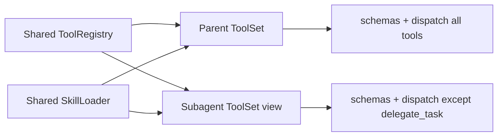

排除同时作用于 `tools`、`schemas()` 和 `dispatch()`：即使模型伪造被排除工具的调用，分发也会返回 `Tool not found`。后续在任意共享视图上注册的新工具会进入同一个 Registry，并对所有未按名称排除它的视图可见。

当前视图模型只支持按名称排除，不支持按权限标签、只读能力或资源范围构建 allowlist。新增面向低信任子代理的工具时，应重新检查所有既有视图是否会意外获得该能力。

### Tool 分发和错误归一化

工具调用链为：

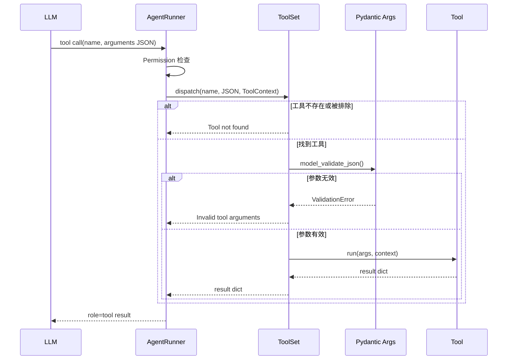

`ToolSet.dispatch()` 将常见失败统一成结构化结果：

- 未注册或被排除：`{"ok": false, "error": "Tool not found: ..."}`。
- Pydantic 校验失败：`Invalid tool arguments`，并附带 `details`。
- Tool 抛出其他异常：捕获异常类型和消息并返回，不让异常越过分发边界。

Tool 的正常返回值必须是可 JSON 序列化的字典，因为 Runner 会使用 `json.dumps()` 写入 tool 消息。当前分发层不会主动验证返回类型和可序列化性；如果 Tool 返回文件句柄、Path 等未转换对象，错误会发生在 Runner 组装历史时。

所有 Tool 当前都是同步 `run()` 接口。慢操作应交给 `background_task` 的 handler 或在后续增加异步分发协议，不能直接在普通 Tool 中无限阻塞 Runner。

### Tool 与 Permission 的衔接

Permission 在 `ToolSet.dispatch()` 之前运行。Runner 从原始参数 JSON 中尽力解析字典，并依据工具名和参数做安全决策；真正的类型校验仍由 Pydantic 完成。

这意味着新增 Tool 时必须同时回答两个问题：

1. 模型是否有权看到和调用该 Tool？由 ToolSet 视图决定。
2. 调用在什么条件下可以执行？由 Permission 和 Tool 内部边界决定。

当前 Permission 只特殊处理 Bash 和 workspace 外文件路径。其他新工具默认不会触发额外确认，因此任何可能写文件、访问网络、发送消息或修改外部状态的新工具都必须显式增加权限规则，并在 Tool 内再次验证不可跨越的安全边界。

Permission 拒绝与 Tool 执行失败语义不同：拒绝会停止当前 Agent 工具循环；普通 Tool 失败会作为结果返回模型，模型可以修正参数后继续调用。

### 新增 Tool 的步骤

开发一个新工具通常包括：

1. 定义继承 `BaseModel` 的参数模型，把类型和取值约束编码进字段。
2. 定义继承 `BaseTool[Args]` 的工具类，并绑定唯一的 `name`、明确的 `description` 和 `args_model`。
3. 实现同步 `run(args, context)`，返回稳定、可 JSON 序列化的结果字典。
4. 通过构造函数注入外部依赖，不在 Tool 中读取宿主全局状态。
5. 在默认 `ToolSet` 或应用装配阶段注册实例。
6. 为有副作用的操作增加 Permission 规则和 Tool 内部安全校验。
7. 检查主 Agent、子代理和其他 ToolSet 视图应该看到还是排除该工具。
8. 添加 schema、参数错误、成功、失败、权限和视图隔离测试。

建议保持统一结果形态：

```json
{
  "ok": true,
  "result": {}
}
```

或：

```json
{
  "ok": false,
  "error": "Actionable error message"
}
```

错误信息应让模型能够决定是修正参数、换用其他工具还是向用户报告失败；不要只返回无法行动的通用文本。

### Skill 文件格式和发现

Skill 默认位于当前 workspace 的 `.agents/skills/`。`SkillLoader` 在构造时递归查找所有 `SKILL.md`：

```text
.agents/skills/
├── agent-builder/
│   └── SKILL.md
└── mcp-builder/
    └── SKILL.md
```

推荐使用 YAML frontmatter：

```markdown
---
name: repository-release
description: Prepare and verify a repository release
tags: release, changelog, git
---

# Repository Release

Follow these checks before publishing...
```

字段语义为：

- `name`：模型调用 `load_skill` 时使用的稳定标识；缺失时使用 `SKILL.md` 的父目录名。
- `description`：进入 SYSTEM 的简短用途说明，应明确何时使用。
- `tags`：可选的补充检索提示，也会显示在 SYSTEM 中。
- frontmatter 后的正文：加载 Skill 后提供给模型的完整工作说明。

没有 frontmatter 的文件仍可加载，名称回退为父目录名，全文作为正文；描述显示为 `No description`。YAML 解析失败时元数据同样回退为空。

Loader 按路径排序后加载文件。多个 Skill 使用同一个 `name` 时，后加载的条目会覆盖前一个条目；当前没有重复名称报错，因此 Skill 名称应在整个递归目录中保持唯一。

### Skill 两层上下文加载

Skill 采用两层内容暴露，目标是让模型知道有哪些专业知识，同时避免把所有长正文常驻 SYSTEM。

第一层是摘要目录。`get_skill_description()` 只渲染 `name`、`description` 和可选 `tags`，由 `build_system_prompt()` 放入主 Agent SYSTEM：

```text
Available skills:
  - repository-release: Prepare and verify a repository release [release, changelog, git]
```

第二层是正文加载。主 Agent SYSTEM 要求任务匹配 Skill 时先调用：

```json
{
  "name": "load_skill",
  "arguments": {
    "name": "repository-release"
  }
}
```

`LoadSkill` 返回：

```text
<skill name="repository-release">
...Skill body...
</skill>
```

该内容作为普通 tool 结果进入 `session.history`，参与后续模型请求，也会受到工具结果预算、旧结果压缩和消息数量裁剪。

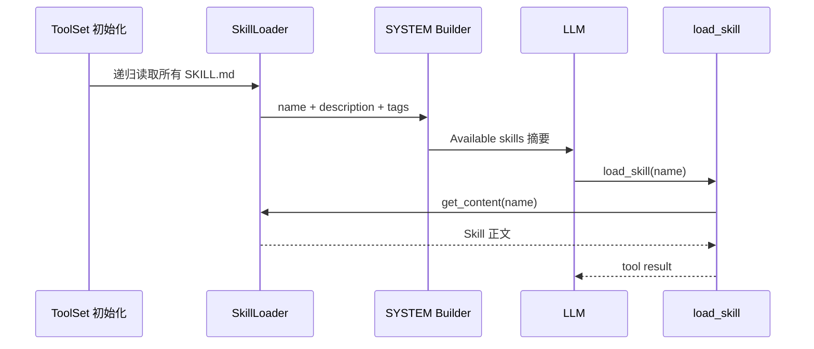

“按需加载”指正文按需进入模型上下文，不表示调用 `load_skill` 时才读取磁盘。SkillLoader 在 ToolSet 初始化时已经把所有元数据和正文载入内存；运行期间新增或修改 `SKILL.md` 不会自动生效，需要重新构造 SkillLoader 或增加显式 reload 机制。

### Skill 在主 Agent 和子代理中的作用域

主 ToolSet 与子代理 ToolSet 视图共享同一个 SkillLoader，因此二者看到相同的 Skill 目录，并使用同一个 `load_skill` 工具实例。子代理 SYSTEM 也包含 Skill 摘要，但子代理拥有独立 Session；子代理加载的正文只进入子代理历史，返回父 Agent 的通常只有最终结果。

Skill 内容属于模型指令上下文，不是可信执行代码。它可以建议模型调用 Tool，但不能绕过：

- ToolSet 的工具可见性和排除规则。
- AgentRunner 的 Permission 检查。
- 文件工具与 BashTool 的 workspace 边界。
- Tool 参数模型和内部业务校验。

当前 Loader 不对 Skill 来源、内容或 frontmatter schema 做信任校验。把外部仓库中的 Skill 放入 `.agents/skills/` 等同于允许其内容影响模型行为，因此安装和更新 Skill 应视为代码审查级别的变更。

### 新增 Skill 的步骤

1. 在 `.agents/skills/<skill-name>/` 下创建 `SKILL.md`。
2. 提供全局唯一、稳定且便于模型精确调用的 `name`。
3. 用简短 `description` 写清触发条件和任务范围，而不是重复正文摘要。
4. 在正文中写明目标、步骤、边界、可使用的 Tool 和完成标准。
5. 避免依赖父对话中的隐含信息；Skill 应能在主 Agent 和隔离子代理中独立理解。
6. 重启应用或重建 ToolSet，使新的 Skill 被 Loader 发现。
7. 验证摘要出现在 SYSTEM、`load_skill` 能返回正文、未知名称返回可用列表。

如果只是增加专业知识或工作规范，优先使用 Skill；如果需要读取、计算或修改外部状态，则需要 Tool。一个完整能力通常由 Skill 描述工作流，再由多个小而明确的 Tool 提供原子操作。

### 当前限制与后续演进

- Tool 返回值缺少统一的运行时 schema 和可序列化性校验。
- Tool 只支持同步执行，取消、超时和流式进度需要各工具自行实现或交给 Background Task。
- ToolSet 视图是按名称 denylist，不是显式 capability allowlist。
- 动态注册不会刷新一次正在执行的 Agent run 所持有的 schema 列表。
- Skill 只在初始化时扫描，没有文件监听、热重载或版本信息。
- Skill 重名会覆盖，frontmatter 字段也没有 Pydantic schema 校验。
- Skill 正文进入历史后依赖通用 Context 压缩，没有独立缓存或引用恢复协议。

## Subagent

Subagent 用于把一个边界清晰的子任务放入独立上下文执行，避免探索过程、工具输出和中间推理占满父 Session。当前实现复用同一个 AgentRunner 和 Tool Registry，以最小机制获得上下文隔离。

核心实现位于：

- `src/tools/subagent/delegate_task.py`：暴露给父 Agent 的委派工具。
- `src/runtime/subagent_service.py`：创建隔离 Session 并运行子 Agent。
- `src/prompts/subagent.md`：子 Agent 专用 SYSTEM。
- `main.py`：构造子代理 ToolSet 视图并完成依赖装配。

### 设计目标和非目标

当前 Subagent 的主要目标是：

- 隔离父对话历史，减少父 Session 的 Context 污染。
- 复用已有模型循环、Tool、Skill、Permission 和压缩机制。
- 只把子任务最终结果返回父 Agent，而不是复制完整执行轨迹。
- 禁止子 Agent 再次委派，避免无界递归。

它当前不是：

- 并发或分布式 worker。
- 独立进程、容器或安全沙箱。
- 可持久化、可恢复的子任务调度系统。
- 具有 explore、plan、code 等不同角色的 Agent 类型系统。

### 装配关系

主程序按以下顺序装配：

```python
toolset = ToolSet()
runner = AgentRunner(...)

subagent_toolset = toolset.view(
    exclude={"delegate_task"},
)
subagent_service = SubagentService(
    runner=runner,
    toolset=subagent_toolset,
)

toolset.register(
    DelegateTaskTool(service=subagent_service)
)
```

父 Agent 和子 Agent 共享：

- 同一个 `AgentRunner`，因此共享模型客户端、workspace、迭代上限和压缩配置。
- 同一个 Tool Registry 中的工具实例。
- 同一个 SkillLoader 和 Skill 目录。
- 同一个文件系统 workspace，以及工具造成的外部副作用。

二者不共享：

- `Session.history`。
- `Session.tool_state`。
- Session 级 Bash 授权。
- 父 Agent 的 Memory 上下文和动态 SYSTEM。

ToolSet 视图排除 `delegate_task`，因此该工具不会出现在子 Agent schema 中；即使模型伪造调用，dispatch 也返回 `Tool not found`。

### 委派输入契约

父 Agent 通过单一参数委派：

```json
{
  "task": "A complete, self-contained task for a subagent."
}
```

`DelegateTaskArgs` 不包含 agent type、模型、超时、优先级或父 Session ID。子 Agent 看不到父历史，因此 `task` 必须包含完成工作所需的目标、范围、约束、相关文件和期望输出。把“继续刚才的修改”之类依赖隐含上下文的描述交给子 Agent，通常会产生不完整结果。

任务字符串会先 `strip()`；空任务直接返回 `Subagent task cannot be empty`，不会创建子 Session。

### 隔离 Session 和 SYSTEM

每次委派都会创建一个新的临时 Session：

```python
Session(
    model=parent_session.model,
    history=[
        {"role": "user", "content": task}
    ],
)
```

这意味着子 Agent：

- 使用父 Session 当前模型，但拥有新的随机 Session ID。
- 从一条自包含 user 任务开始，没有父消息、父 Todo 或父权限授权。
- 使用专用 SYSTEM，明确自己是隔离子代理，只返回最终结果。
- 可以看到共享 Skill 摘要，并通过 `load_skill` 把正文加载进自己的历史。
- 不自动加载父 Session 的 Memory 索引或相关 Memory。

`SubagentService` 当前使用 `Path.cwd()` 渲染 SYSTEM 中的 workspace，而 Runner 和文件工具各自保存初始化时的 workspace。正常从项目目录启动时三者一致；如果宿主显式传入不同 workdir，后续应统一从一个 WorkspaceContext 取得路径。

### 同步执行流程

`delegate_task` 是普通同步 Tool。父 Runner 调用它后，会在同一线程进入第二个 `AgentRunner.run()`，直到子 Agent 返回最终文本或失败，父 Agent 才继续。

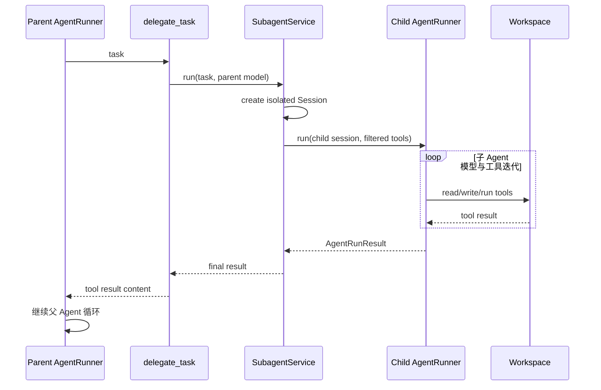

当前没有线程池或并行调度，因此多个委派调用会按父 Runner 处理 tool call 的顺序串行执行。子 Agent 的模型请求仍使用统一重试，工具循环仍受 `max_tool_iterations` 限制。

### 上下文隔离不等于副作用隔离

子 Agent 虽然看不到父历史，但它使用共享工具实例和同一个 workspace：

- 子 Agent 写入或编辑的文件会立即对父 Agent 可见。
- Task 和 Background Task manager 等工具实例及其底层存储与父 Agent 共享。
- 子 Agent 执行的 Bash 命令作用于同一项目目录。
- 子 Agent 加载 Skill 只改变自己的历史，不会把 Skill 正文复制到父历史。

因此 Subagent 提供的是 Context isolation，而不是 filesystem、process 或 security isolation。父 Agent 只能委派允许子 Agent 在共享 workspace 中实际执行的任务。

### Permission 行为

子 Agent 复用同一个 Runner，所以 Bash 和文件工具仍经过相同 Permission 检查及工具内部 workspace 校验。但是子 Session 的 `approved_command_prefixes` 初始为空，不继承父 Session 的授权。

`SubagentService.run()` 没有传入自定义 `confirm_permission` callback。需要确认的 Bash 命令会进入 Runner 的默认终端确认流程；用户给出的 Session 级授权只写入临时子 Session，委派结束后不会持久化。

Skill 或子任务文本都不能绕过 ToolSet 排除、Permission 硬拒绝和具体 Tool 的安全边界。与此同时，允许执行并不代表隔离执行：用户一旦批准，副作用仍发生在共享 workspace。

### 结果回传

子 Agent 正常结束时，`DelegateTaskTool` 只返回：

```json
{
  "ok": true,
  "content": "child final response"
}
```

父 Session 只保存 `delegate_task` 的 tool call 和这个结果，不保存子 Agent 的完整历史、工具轨迹或临时 Session。父 Agent 可以基于结果继续工作或向用户总结。

如果子 Runner 返回 `ok=False`，工具转换为：

```json
{
  "ok": false,
  "error": "child error"
}
```

当前包装层不会向父 Agent 保留 `stopped_by_permission` 和 `waiting_for_background` 等细分状态。权限拒绝在 Runner 中属于 `ok=True`，因此会作为普通内容返回；子 Agent 提交后台任务后也没有持久化 Session 或唤醒入口来可靠接收完成事件。

### 适用场景

适合委派：

- 搜索一组文件并返回结论。
- 对独立模块进行实现或检查。
- 执行会产生大量中间工具输出、但父 Agent 只需要结论的工作。
- 使用专业 Skill 完成边界明确的子任务。

不适合委派：

- 强依赖父对话隐含决策、又无法在 task 中完整描述的工作。
- 需要与父 Agent 高频双向沟通的任务。
- 需要并行、取消、进度展示或进程级隔离的长任务。
- 依赖 Background Task 完成后恢复子 Session 的流程。

### 当前限制与后续演进

- 只有一种通用 Subagent，没有按角色定义 SYSTEM 和能力 allowlist。
- 执行是同步串行的，父 Runner 在子 Agent 完成前被阻塞。
- 子 Session 不持久化，无法恢复、审计完整轨迹或接收后续事件。
- 只返回最终文本，没有结构化产物、引用、状态或工具使用摘要。
- 没有父子取消、超时预算、token 预算、进度事件和并发上限。
- ToolSet 使用共享 Registry 的 denylist 视图；更严格的设计应为不同 Agent 类型使用显式 capability allowlist。
- 子 Agent 可以修改共享 workspace；需要更强隔离时应使用独立 worktree、容器或受限文件系统。
- 应补充 Subagent 的隔离历史、递归阻断、权限授权不继承和失败传播测试。

## AgentRunner

`AgentRunner` 是单轮 Agent 执行的控制中枢。它不负责读取终端输入或持久化 Session，而是接收已经准备好的 `Session`、`ToolSet` 和 SYSTEM prompt，在同步循环中完成模型请求、工具调用、权限检查和结果回填。

核心实现位于：

- `src/runtime/agent_runner.py`：模型与工具循环、权限决策、上下文自动压缩和后台事件注入。
- `src/runtime/session.py`：本轮执行所操作的会话状态。
- `src/tools/toolset.py`：工具 schema 暴露、参数校验和实际分发。
- `main.py`：构造 SYSTEM、调用 Runner、展示结果和持久化 Session。

### 输入和返回值

`AgentRunner.run()` 的主要输入为：

```python
runner.run(
    session=session,
    toolset=toolset,
    system_prompt=turn_system_prompt,
    on_tool_requested=...,
    confirm_permission=...,
    on_tool_result=...,
)
```

SYSTEM 不写入 `session.history`，而是在每次模型请求时临时放到消息列表最前面。这样同一个 Session 可以在不同轮次使用重新构建的 SYSTEM，例如更新 Memory 索引或相关 Memory，而不会把旧 SYSTEM 固化到历史中。

返回值统一为：

```python
AgentRunResult(
    ok=True | False,
    content=None,
    error=None,
    stopped_by_permission=False,
    waiting_for_background=False,
)
```

- `ok=False` 表示模型请求失败或达到最大工具迭代次数。
- `stopped_by_permission=True` 表示本轮因硬拒绝或用户拒绝而停止。
- `waiting_for_background=True` 表示本轮已经正常结束，但当前 Session 仍有后台任务未完成；Runner 本身不会等待或主动重新唤醒 Session。

### 单轮执行流程

每次迭代按以下顺序执行：

1. 注入属于当前 Session、尚未确认的后台任务终态事件。
2. 对 `session.history` 应用消息数量限制。
3. 如果 Todo 长时间未更新，将 Todo reminder 临时追加到本次 SYSTEM。
4. 调用模型，必要时执行输出截断恢复。
5. 将 assistant 消息追加到 `session.history`。
6. 如果没有工具调用，执行自动压缩并结束本轮。
7. 如果存在工具调用，逐个执行权限检查、工具分发并追加对应的 tool 消息。
8. 一批工具处理完成后压缩历史，再进入下一次模型请求。

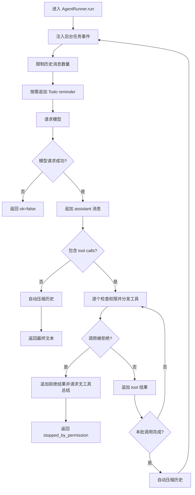

默认最多执行 `MAX_TOOL_ITERATIONS=10` 次模型与工具循环。达到上限时返回 `ok=False`，历史中已经完成的消息和工具结果不会回滚。

### 工具调用消息链

Runner 会先保存模型产生的完整 assistant 消息及其 `tool_calls`，再执行工具。每个已处理的调用都会追加：

```json
{
  "role": "tool",
  "tool_call_id": "call_xxx",
  "content": "{\"ok\": true, ...}"
}
```

工具参数由 `ToolSet.dispatch()` 使用对应 Pydantic 模型校验。工具抛出的参数错误或未知工具会被转换为结构化失败结果，仍作为 tool 消息返回给模型。

当前权限拒绝采用 fail-fast：遇到第一个被拒绝的调用后，本批剩余调用不再执行。Runner 会追加当前调用的拒绝结果，然后发起一次 `tools=[]`、`tool_choice="none"` 的总结请求并结束本轮。对于一个 assistant 消息同时包含多个 tool call 的情况，被跳过的后续调用当前不会生成占位 tool 结果，这是现有实现的协议边界，后续若要严格保证多工具消息链完整，应为所有跳过调用补充 cancelled 结果。

### 输出截断恢复

当模型响应的 `finish_reason` 或 `stop_reason` 表示达到 token 上限时，Runner 分两阶段恢复：

1. 使用原始消息重新请求一次，并把 `max_tokens` 提高到初始值的 8 倍。
2. 如果仍被截断，保存该次部分文本，并最多追加 3 次 continuation 请求。

continuation 请求要求模型从中断位置继续且不要重复。最终文本由各段直接拼接，并作为一条 assistant 消息写入 Session。进入 continuation 模式后，恢复响应中的工具调用不会被执行，恢复流程只用于生成文本结果。

### 失败边界

- 模型请求仅对 429 和 529 执行有限重试；最终失败返回 `ok=False`，不伪造 assistant 回复。
- 工具本身的失败是正常 tool 结果，不会直接终止 Agent 循环，模型可以读取错误并修正参数。
- 权限拒绝会终止当前工具循环，但属于受控结束，因此返回 `ok=True` 和 `stopped_by_permission=True`。
- 后台事件读取或确认失败会被限制在事件注入阶段，不阻断当前模型请求。
- Todo reminder 和 SYSTEM 都是每次请求临时组装的上下文，不写入会话历史。

## Permission

Permission 层位于模型产生工具调用和工具真正执行之间，目标是阻止明确危险的 Bash 命令、自动放行可证明安全的只读命令，并让其他命令由用户决定是否执行。

权限判断返回：

```python
tuple[str | None, bool]
```

| `reason` | `hard_denied` | 行为 |
| --- | --- | --- |
| `None` | `False` | 自动执行 |
| 非空 | `False` | 请求用户确认 |
| 非空 | `True` | 直接拒绝，不允许确认覆盖 |

### Bash 四层决策

Bash 按固定优先级检查：

1. **硬拒绝**：规范化命令的空白和大小写后，检查 `DENY_LIST` 子串，例如 `sudo`、`shutdown`、`mkfs` 和 `rm -rf /`。命中后直接拒绝。
2. **语法和路径约束**：包含 shell 操作符、换行、绝对路径、`..` 路径或 workspace 外 `cwd` 的命令不能自动执行。
3. **自动允许或 Session 授权**：严格只读前缀或当前 Session 已授权的命令前缀可以自动执行。
4. **用户确认**：其余命令询问用户，仅本次允许、在当前 Session 允许或拒绝。

自动允许的 Bash 前缀当前为：

```text
pwd
ls
rg
grep
head
tail
wc
git status
git diff
git log
```

仅命中前缀还不够。命令必须能被 `shlex.split()` 正确解析，不包含以下 shell 展开或组合字符，并且路径检查通过：

```text
| & ; > < ` $ ( ) { } * ? [ ] ~
```

因此 `git status` 可以自动执行，而 `git status && touch marker`、`rg "*.py"` 和 `ls > files.txt` 都需要确认。

### Session 级命令授权

用户选择 Session 级允许时，Runner 使用 `shlex.split()` 解析命令并保存前两个 token；只有一个 token 时保存一个。例如：

```text
npm install package-a  -> ("npm", "install")
pytest                  -> ("pytest",)
```

授权保存在 `Session.approved_command_prefixes`，并由 `SessionStore` 写入 SQLite。因此它的作用域是逻辑 Session：切换到其他 Session 不共享，但同一 Session 在进程重启后通过 `/resume` 恢复时仍然有效。

Session 授权不能覆盖硬拒绝、shell 操作符检查和 workspace 路径约束。例如授权 `npm install` 后，`npm install package-b` 可以自动执行，但 `npm install package-b && shutdown` 仍会被拦截。

### 文件工具和纵深防御

`read_file`、`write_file` 和 `edit_file` 的目标路径如果位于 workspace 外，Permission 层会要求确认。但用户确认不是最终安全边界：三个文件工具在实际执行时会再次解析路径并拒绝 workspace 逃逸。

`BashTool` 同样会在执行前验证 `cwd`：

```python
workdir.is_relative_to(project_root)
```

这可以避免 `/project-secrets` 被错误识别成 `/project` 的子目录。Bash 当前仍使用 `shell=True`，Permission 层只是在应用层降低风险，不等价于操作系统沙箱。

### 拒绝后的行为

硬拒绝或用户拒绝后：

1. 不调用具体工具。
2. 为当前调用追加 `ok=false` 的 tool 结果。
3. 停止本批后续工具调用。
4. 发起一次禁止工具调用的自然语言总结请求。
5. 返回 `stopped_by_permission=True`。

如果总结请求失败或返回空内容，Runner 使用固定说明作为降级结果。下一条用户输入仍可开始新的 Agent run。

### 扩展约束和当前限制

- 新增有副作用的工具时，必须显式增加 Permission 规则；当前未知工具在 Permission 层默认没有额外限制。
- 安全边界必须在具体工具中再次实现，不能只依赖 Runner 的检查。
- `DENY_LIST` 当前是规范化后的子串匹配，可能同时产生误报和漏报；它不是 shell AST 或系统级隔离。
- Session 级授权会持久化，但 `/clear` 当前只清空 history 和 `tool_state`，不会清空 `approved_command_prefixes`。
- 多 tool call 消息在中途拒绝时，未执行调用尚未获得 cancelled tool 结果。

## Session

`Session` 是一次逻辑对话的运行时状态容器。模型客户端、ToolSet、SYSTEM 和 workspace 不属于 Session；Session 只保存恢复对话和工具状态所需的数据。

```python
Session(
    model="model-name",
    session_id="uuid4",
    history=[],
    tool_state={},
    approved_command_prefixes=set(),
    running=True,
    provider_id=None,
)
```

### 字段职责

| 字段 | 作用 | 是否持久化 |
| --- | --- | --- |
| `session_id` | 逻辑会话唯一标识 | 是 |
| `model` | 当前模型名称 | 是 |
| `provider_id` | 当前模型供应商 | 是 |
| `history` | user、assistant 和 tool 消息链 | 是 |
| `tool_state` | Todo、后台事件去重等工具运行状态 | 是 |
| `approved_command_prefixes` | Session 级 Bash 授权 | 是 |
| `running` | 主输入循环是否继续 | 否，加载时重置为 `True` |

### SQLite 持久化模型

默认数据库位于 `~/.swe-agent/state.db`，可通过 `SWE_AGENT_DB_PATH` 覆盖。Session 相关表为：

```text
sessions
├── id, title, provider_id, model
├── workdir, status
└── created_at, updated_at

session_messages
├── session_id, sequence, role, content
└── payload_json

session_state
├── session_id
├── tool_state_json
└── approved_prefixes_json
```

`payload_json` 保存完整消息对象，因此 assistant 的 `tool_calls` 和 tool 的 `tool_call_id` 不会因为拆列而丢失；`role` 和 `content` 列主要用于查询和展示。

`SessionStore.save()` 在一个数据库事务内完成：

1. upsert Session 元数据并更新 `updated_at`。
2. 删除该 Session 现有消息行。
3. 按当前 `history` 顺序重新写入全部消息。
4. upsert `tool_state` 和命令授权。

这种策略简单地保证内存快照与数据库一致，但写入成本随历史长度线性增长，不适合超长会话或高频并发保存。SQLite 开启 foreign key、5 秒 busy timeout 和 WAL；当前仍是单进程本地状态库设计。

### 主程序中的保存时机

普通用户请求按以下顺序处理：

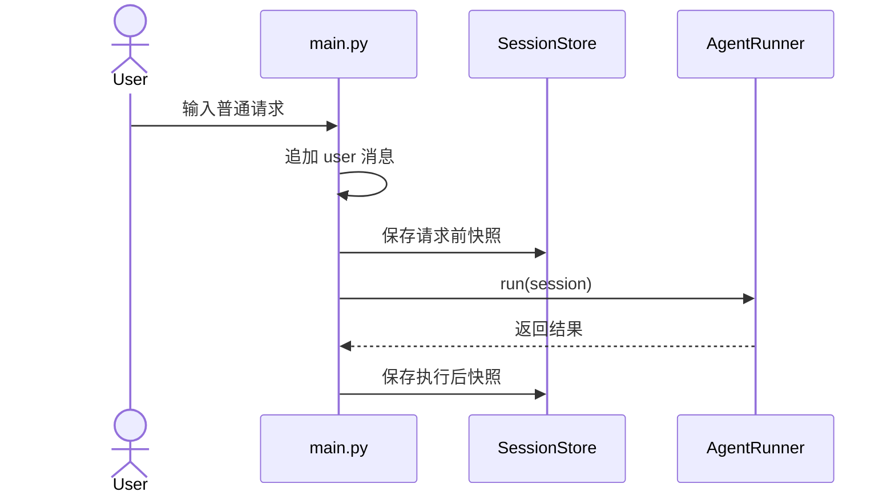

请求前保存保证即使模型调用失败，用户输入也不会丢失；请求后保存则记录 assistant、tool 和运行时状态。程序退出前还会再保存一次。

启动时创建的空 Session 不会立即落库，避免用户未进行任何操作就产生空记录。但 `/new` 会显式创建一个持久化 Session。

### Session 命令语义

- `/new [title]`：创建新 Session，并把共享的当前 Session 对象切换到新 ID 和新状态。
- `/resume <id>`：从数据库加载完整历史、工具状态和命令授权，再覆盖当前 Session 对象；保持其他组件持有的对象引用有效。
- `/clear`：清空 `history` 和 `tool_state`；如果 Session 已持久化则立即保存。它不会更换 Session ID，也不会清空命令授权。
- `/sessions`：按 `updated_at` 倒序列出 Session 摘要，不加载完整消息历史。

Session 的 `workdir` 当前保存在数据库元数据和摘要中，但不是 `Session` dataclass 字段。恢复 Session 不会自动切换进程工作目录，实际工具边界仍由当前启动时的 workspace 决定。

### 一致性和边界

- `SessionStore.load()` 按 `sequence` 恢复消息，保证工具调用链顺序不变。
- 删除 Session 依赖外键级联删除消息和状态。
- 保存时状态统一写为 `active`；当前尚未实现完整的 archived、running 或 background-waiting 状态机。
- Session 对象不是线程安全容器。后台 worker 不直接修改 `history`，而是通过持久化事件在下一次 Runner 调用时注入。
- `/compact` 修改内存中的 `history`，由后续保存点写入数据库；显式命令本身当前不直接调用 `SessionStore.save()`。

## Context 压缩

Context 压缩用于限制发送给模型的历史长度和单条工具输出体积，同时尽量保留最近工作状态与完整工具调用结构。实现位于 `src/infrastructure/compact.py`，分为自动压缩和显式 LLM 摘要两条路径。

### 自动压缩流水线

Runner 在每次模型请求前检查消息数量，并在一轮工具处理、普通回答或权限拒绝结束后依次执行：

```text
tool_result_budget
        ↓
micro_compact
        ↓
snip_compact
```

所有函数都直接修改或替换 `session.history`，压缩后的历史会在正常保存点持久化。

#### 工具结果预算

当 tool 消息正文超过 `TOOL_RESULT_MAX_CHARS=4000` 字符时，`tool_result_budget()`：

1. 使用 `tool_call_id` 的 SHA-256 作为文件名。
2. 将完整正文保存到 `.swe-agent/tool-results/<hash>.json`。
3. 用归档提示和原正文前缀替换 tool 消息，替换后总长度不超过约 4,000 字符。

如果归档写入失败，该条结果保持原样，避免在无法恢复完整内容时丢弃数据。归档的是 tool 消息中的原始字符串，扩展名虽为 `.json`，内容不额外验证为 JSON。

#### 旧工具结果压缩

`micro_compact()` 保留最近 3 条 tool 结果。更早的结果替换为：

```text
[Earlier tool result compacted. Re-run if needed.]
```

`read_file` 当前在保留名单中，其旧结果不会被这一层替换。工具名称通过历史 assistant 消息中的 `tool_call_id` 映射得到；无法找到名称时按 `unknown` 处理。

#### 消息数量裁剪

当历史超过 `max_history_messages`，默认 50 条时，`snip_compact()` 保留开头少量消息和尽可能多的尾部消息，中间替换为：

```text
[snipped N messages]
```

裁剪以消息组为单位：包含 `tool_calls` 的 assistant 消息与紧随其后的 tool 结果视为同一组，不会在组内切断。占位消息使用 `user` role，使模型明确看到历史发生过省略。

`estimate_tokens()` 当前只提供粗略的 `len(str(messages)) // 4` 估算，尚未接入自动触发逻辑；自动裁剪依据的是消息数量和单条字符数，而不是模型的真实 token 数。

### 显式 `/compact`

`/compact` 使用 LLM 将全部当前历史总结为一条可继续工作的上下文：

1. 先把完整历史逐行写入 `.swe-agent/transcripts/<hash>.jsonl`。
2. 请求当前 Session 的模型生成摘要，要求保留目标、决策、完成项、关键工具结果、文件路径、未解决问题和下一步。
3. 成功后把整个 `history` 替换为一条 `user` 消息，其中包含 transcript 路径和摘要。

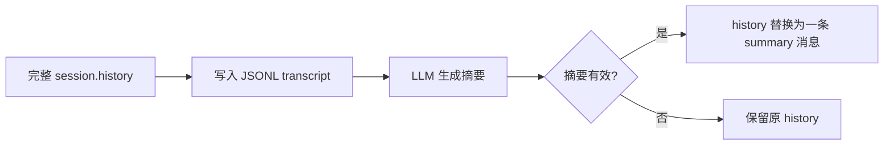

完整 transcript 在调用 LLM 之前写入，因此即使摘要失败也保留可审计副本。模型请求失败、没有 choice 或返回空摘要时，原历史不会被替换。

命令层最多连续尝试 3 次，成功后立即停止；三次均失败则触发本次 compact 的熔断并返回错误。底层模型请求还会对 429 和 529 使用统一重试策略。

### 压缩边界和当前限制

- 自动压缩与 `/compact` 相互独立；Runner 不会根据 token 阈值自动调用 LLM 摘要。
- 自动压缩可能永久改变随后持久化的 Session 历史，但超大工具结果和 `/compact` 都会先留下本地归档。
- `micro_compact()` 按 tool 结果条数而不是工具轮次计算“最近 3 条”。
- `read_file` 结果不受旧结果压缩保护以外的特殊待遇：超过 4,000 字符时仍会先被工具结果预算截断。
- transcript 和工具结果归档当前没有清理、配额或跨 workspace 索引机制。
- `/compact` 的摘要是一条 `user` 消息，不保留原来的逐条 role 结构；需要细节时必须通过 transcript 路径重新读取。

## Memory

Memory 用于跨轮次保存用户偏好、反馈、项目事实和外部引用。它由三部分组成：

- `main.py`：在每次用户请求开始时装配 Memory 上下文，并在本轮结束后提交后台维护任务。
- `src/runtime/memory_worker.py`：负责异步调度提取和整理，不阻塞 Agent 主循环。
- `src/infrastructure/memory.py`：负责 Memory 的检索、LLM side-query、提取、合并和文件持久化。

### 存储格式

Memory 保存在当前工作区的 `.swe-agent/memory/`：

```text
.swe-agent/memory/
├── MEMORY.md                  # name + description 索引
├── user-preference-tabs.md    # 单条 Memory
└── project-language.md
```

每条 Memory 是带 YAML frontmatter 的 Markdown 文件：

```markdown
---
name: user-preference-tabs
description: User prefers tabs for indentation
type: user
---

User prefers using tabs, not spaces, for indentation.
```

支持的 `type` 为：

- `user`：用户偏好。
- `feedback`：用户对 Agent 工作方式的指导或纠正。
- `project`：项目事实、约束和约定。
- `reference`：外部资料或引用位置。

`MemoryStore` 由 `main.py` 使用工作区、模型客户端和模型名称构造：

```python
memory_store = MemoryStore(
    workdir,
    client=provider.client,
    model=MODEL,
)
```

工作区路径由应用入口决定，Infrastructure 层不读取 `main.py` 的全局变量。

### 每轮开始：加载 Memory

Memory 通过两条路径进入当前轮上下文。

#### 路径一：索引常驻 SYSTEM

每次收到普通用户请求后，`main.py` 调用 `build_system_prompt()`：

1. 读取 `.swe-agent/memory/MEMORY.md`。
2. 将完整的 Memory 索引追加到 `Persistent memory index` 段落。
3. 将生成的 SYSTEM 传给本轮 `AgentRunner.run()`。

一次 `AgentRunner.run()` 内可能有多次模型和工具迭代，但它们复用同一个 SYSTEM。Memory 提取和整理只在整轮结束后触发，因此同一轮内不重复读取索引或重建 SYSTEM。

#### 路径二：相关 Memory 按需注入

`load_memories(session.history)` 在本轮 Agent 执行前加载相关 Memory：

1. `list_memory_files()` 只收集每条 Memory 的 `filename`、`name` 和 `description` 作为候选目录。
2. 最近对话截取最后 4,000 个字符，与候选目录一起发送给 LLM side-query。
3. side-query 只允许返回候选目录中的精确文件名，最多选择 5 条。
4. `load_memories()` 读取选中文件的正文，并渲染为 `<memory>` 块。
5. `main.py` 将这些块追加到当前轮的 `turn_system_prompt`，不写回 `session.history`。

如果 API 请求失败、响应为空、JSON 无法解析，或者 LLM 没有返回有效文件名，`select_relevant_memories()` 会自动降级为本地关键词匹配。关键词只匹配 Memory 的 `name + description`，名称命中的权重高于描述。

### 每轮结束：异步提取和整理

本轮 `AgentRunner.run()` 返回后，`main.py` 调用：

```python
memory_worker.submit(session.history)
```

`MemoryWorker.submit()` 会先深拷贝消息快照，然后把任务提交到单线程 `ThreadPoolExecutor`。主线程不等待任务结果，立即回到输入提示，因此用户可以继续提交下一条指令。

后台任务固定按以下顺序执行：

1. `extract_memories(messages)` 提取新 Memory。
2. `consolidate_memories()` 在达到阈值时合并重复、冲突或过期 Memory。

单线程队列保证不同轮次的后台任务串行执行，避免多个任务同时修改 Memory 目录。后台维护异常会被限制在 `MemoryWorker` 内，不会中断 Agent 主循环；失败的整理可以在后续轮次重试。

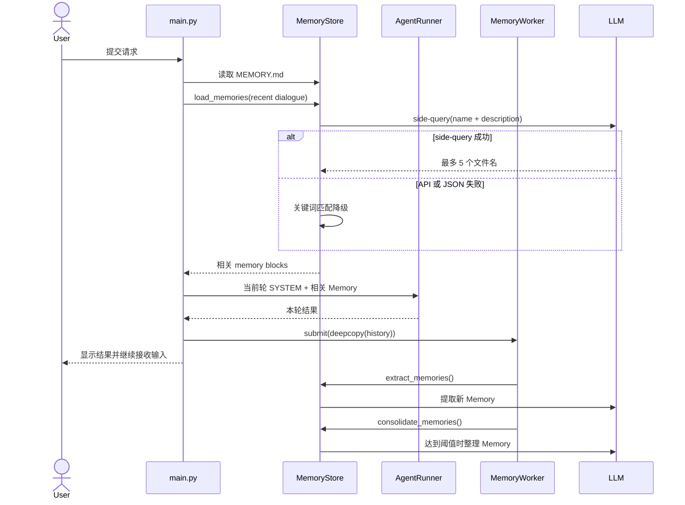

### 新 Memory 提取

`extract_memories()` 将最近对话和现有 Memory 的名称、描述发给 LLM，要求返回 JSON 数组：

```json
[
  {
    "name": "user-preference-tabs",
    "type": "user",
    "description": "User prefers tabs for indentation",
    "body": "Always use tabs when writing or editing files."
  }
]
```

写入前会校验必填字段和 Memory 类型，并跳过已有的同名 Memory。有效记录通过 `MemoryStore.write()` 写入独立 Markdown 文件，随后重建 `MEMORY.md`。

### Memory 整理

当 Memory 文件数量达到 `CONSOLIDATE_THRESHOLD`（当前为 10）时，`consolidate_memories()` 调用 LLM 检查重复、冲突和过期记录。LLM 返回：

```json
{
  "memories": [
    {
      "name": "coding-style",
      "type": "user",
      "description": "Preferred coding style",
      "body": "Use tabs consistently."
    }
  ],
  "remove": [
    "style-tabs.md",
    "style-spaces.md"
  ]
}
```

整理过程先写入合并后的 Memory，再删除 `remove` 中明确列出的源文件。删除范围被限制为当前 Memory 目录中已存在的文件，并且不会删除刚写入的目标文件。完成后重新生成 `MEMORY.md`。

### 一致性和失败边界

- Memory 文件和 `MEMORY.md` 使用同目录临时文件加原子替换写入，主线程不会读到半写入内容。
- side-query 失败只影响相关 Memory 的精确度，会降级为关键词匹配。
- 后台提取或整理失败不会影响当前回答或下一轮用户输入。
- `MemoryWorker` 只有一个工作线程，保证提取、整理和文件删除按轮次顺序执行。
- `/clear` 等 slash command 不会触发 Memory 提取；只有执行过 `AgentRunner.run()` 的普通用户请求会在结束时提交后台任务。

## Task 系统

Task 系统用于把“任务记录管理”和“慢任务执行”分开：

- `task_manager` 负责快速、同步的任务管理操作，例如创建任务、查询任务、领取任务和完成任务。
- `background_task` 负责提交可能阻塞主循环的慢操作，例如模型调用、批量处理、长时间 I/O 或子代理任务。

这里的 `Task` 是任务记录和依赖关系，`BackgroundTask` 是带有执行处理器的异步任务。两者使用相同的任务 ID 格式，但保存在不同目录中，不直接共享状态文件。

### 代码结构

```text
src/tools/task/
├── task.py              # Task、TaskArgs、TaskManager
├── background_task.py   # BackgroundTask、BackgroundTaskManager、线程池 worker
└── store.py             # 原子 JSON 写入和线程安全文件存储
```

工具注册在 `src/tools/toolset.py`：

```text
ToolSet
├── task_manager
└── background_task
```

`AgentRunner` 通过 `ToolSet.background_task_manager` 访问后台任务管理器，并在每次模型请求前检查完成事件。

### 快速任务模型

快速任务的数据结构如下：

```python
Task(
    id="task_<32 位小写十六进制字符>",
    subject="任务标题",
    description="任务描述",
    status="pending | in_progress | completed",
    owner=None,
    blockedBy=[],
)
```

任务 ID 使用 UUID4 的随机部分生成：

```text
task_ + uuid4().hex
```

这种 ID 具有较低的碰撞概率，并且可以安全地作为文件名。它不表达创建时间，因此列表排序是字典序，而不是创建时间顺序。

快速任务的工作流为：

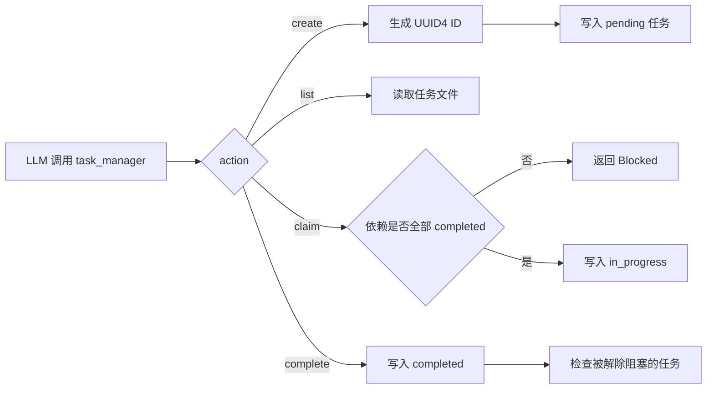

`blockedBy` 中的每个任务 ID 都必须合法，并且只有所有依赖任务为 `completed` 时，当前任务才能被领取。当前实现会对 `blockedBy` 去重，但不会自动创建不存在的依赖任务。

### 后台任务模型

后台任务除了任务描述，还保存执行器信息和结果：

```python
BackgroundTask(
    id="task_<32 位小写十六进制字符>",
    subject="慢任务标题",
    description="慢任务描述",
    handler="registered_handler_name",
    payload={},
    session_id="所属会话 ID",
    status="pending | in_progress | completed | failed | cancelled",
    result=None,
    error=None,
    event_id=None,
    created_at=...,
    started_at=None,
    finished_at=None,
    acknowledged_at=None,
)
```

`handler` 保存的是处理器名称，不保存 Python callable。处理器需要由宿主程序注册：

```python
manager = ToolSet().background_task_manager
manager.register_handler(
    "slow_operation",
    lambda payload: do_slow_operation(payload),
)
```

这样任务文件中只保存 JSON 可序列化的 `payload`，避免把不可持久化的函数对象写入磁盘。默认 `ToolSet` 会注册 `background_task`，但默认没有业务 handler；实际应用需要根据自身能力显式注册 handler。

### 后台提交与执行流程

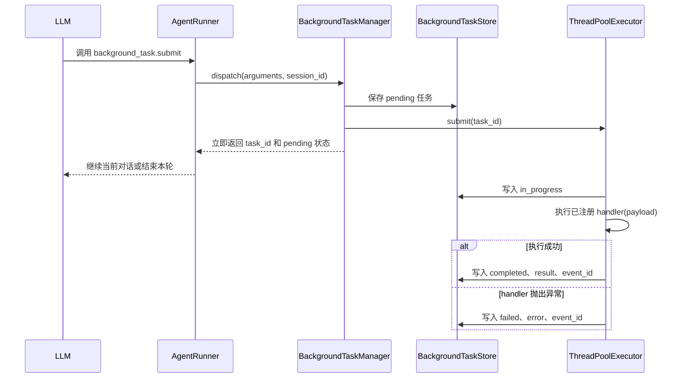

当前 worker 使用 `ThreadPoolExecutor`，默认最多 4 个工作线程。它适合网络请求、模型调用和文件 I/O 等 I/O 密集型操作；CPU 密集型任务如果需要并行，应在后续改用进程池或专用执行服务。

后台任务支持以下工具操作：

| action | 作用 | 是否需要 task |
| --- | --- | --- |
| `submit` | 创建并提交后台任务 | 是，需要 `subject`、`handler`、`payload` |
| `get` | 查询单个任务 | 是，需要 `id` |
| `list` | 查询全部后台任务 | 否 |
| `cancel` | 取消尚未开始的任务 | 是，需要 `id` |
| `retry` | 重新提交失败或已取消的任务 | 是，需要 `id` |

当前实现只允许取消 `pending` 任务。任务一旦进入 `in_progress`，不能被强制终止；如果需要可取消的慢操作，handler 应自行读取取消信号，这部分协议尚未加入当前版本。

### 完成事件注入

后台 worker 不直接修改 `Session.history`，而是把任务写成终态，并生成唯一的 `event_id`。完成状态包括：

```text
completed
failed
cancelled
```

每个后台任务提交时记录当前 `session_id`。`AgentRunner` 每轮开始、发起下一次模型请求之前执行以下流程：

1. 读取当前 session 尚未确认的终态后台任务。
2. 使用 `event_id` 去重。
3. 将任务结果封装为外部事件消息追加到 `session.history`。
4. 调用 `acknowledge_event()` 写入 `acknowledged_at`。
5. 将已注入的 event ID 保存到 `session.tool_state["background_task_event_ids"]`。

注入的消息形态如下：

```text
[Background task event]
A background task assigned to this session reached a terminal state.
{"task_id": "...", "subject": "...", "status": "completed", "result": "...", "error": null}
```

消息使用 `user` role，是因为它代表运行时产生的外部事件，而不是对历史 tool call 的重复响应。消息正文明确要求模型把它当作外部事件处理，而不是新的用户指令。

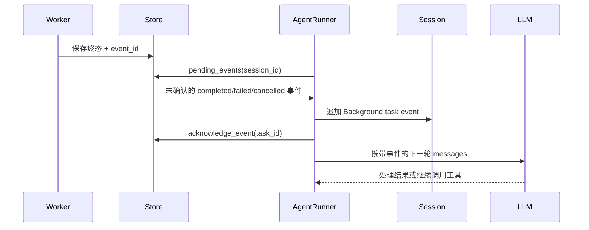

如果同一个任务被 `retry`，会清除旧的确认状态；新的终态会生成新的 `event_id`，因此重试结果不会因为旧任务 ID 已经注入过而被丢弃。

### AgentRunner 的结束行为

`AgentRunner.run()` 仍然是同步的一轮执行。后台任务提交后，如果模型没有继续调用工具，本轮会结束；如果此时仍有属于当前 session 的 `pending` 或 `in_progress` 任务，返回值会设置：

```python
AgentRunResult(
    ok=True,
    waiting_for_background=True,
)
```

这表示上层运行时需要保留该 session，并在后台任务完成后再次调用 `AgentRunner.run()`。下一次调用的第一步就是完成事件注入。

`BackgroundTaskManager` 也支持可选的 `on_task_finished` 回调。宿主程序可以使用这个回调唤醒对应的 session：

```text
worker 完成
    ↓
on_task_finished(task)
    ↓
宿主根据 task.session_id 找到 session
    ↓
重新调用 AgentRunner.run()
```

当前 Task 模块本身不会启动全局 session scheduler，也不会在后台线程中直接发起新的 LLM 请求。这样可以避免同一个 session 被多个线程同时修改历史或并发调用模型。

### 持久化与一致性

任务分别保存于当前工作区：

```text
.swe-agent/
├── tasks/
│   └── task_<id>.json
└── background_tasks/
    └── task_<id>.json
```

`JsonFileStore` 提供两项基础能力：

- 先写入随机临时文件，再使用 `os.replace()` 原子替换目标文件，避免读到半写入内容。
- 在同一个 manager 实例内使用 `RLock`，保护线程内的读写操作。

文件存储只保证单个 manager 实例内的线程安全。当前版本还没有跨进程锁或数据库事务，因此多个进程同时操作同一任务目录时，仍可能发生状态竞争。`TaskManager.claim_task()` 也还没有跨进程 compare-and-swap 保护。

### 快速任务与后台任务的选择

当前版本不额外调用一次 LLM 来判断快慢，而是通过工具能力和工具描述让 LLM 选择：

- 只涉及任务元数据、依赖检查和状态读写：使用 `task_manager`。
- 涉及模型调用、子代理、网络请求、轮询、批量处理或耗时不确定：使用 `background_task`。

后续如果需要统一入口，可以在工具层增加 `TaskRouter`，由 LLM 提供 `mode=auto/foreground/background`，再由运行时根据 handler 元数据和启发式规则做最终裁决。运行时规则应当覆盖明显的慢任务，不能完全依赖 LLM 对耗时的估计。

### 当前限制与后续演进

- handler 注册表目前只存在于进程内；进程重启后，已经提交但尚未完成的后台任务不会自动恢复执行。
- 目前使用线程池，尚未提供进度百分比、超时、强制取消和持久化重试次数。
- 完成事件通过扫描后台任务文件发现，任务规模较大时应改为持久化事件表或事件日志。
- `owner` 当前主要用于任务元数据记录，完成任务时还没有强制校验 owner。
- 如果需要多进程 worker、可靠恢复和严格任务领取语义，应迁移到带事务和锁机制的数据库或队列系统。
