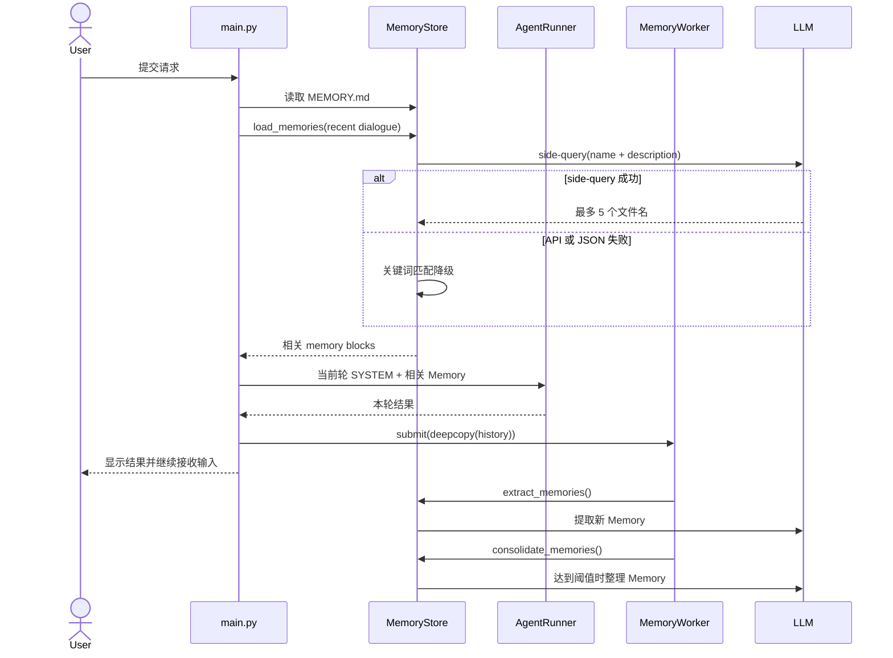
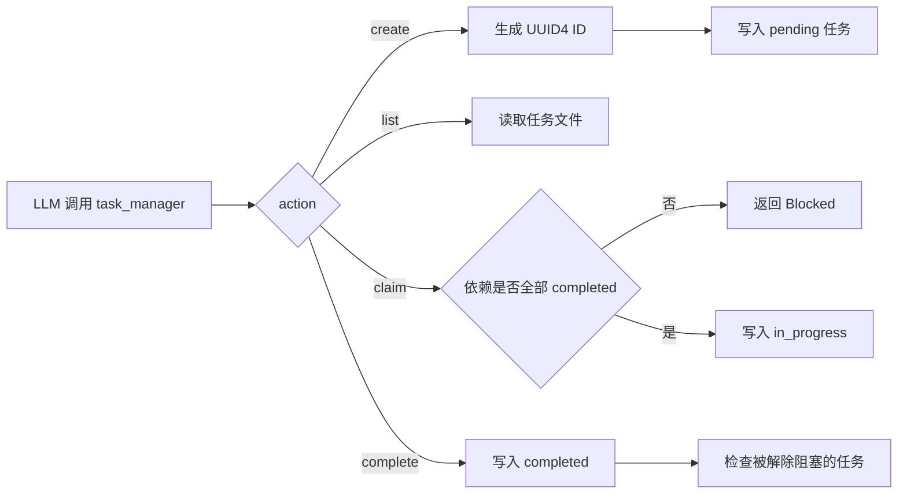
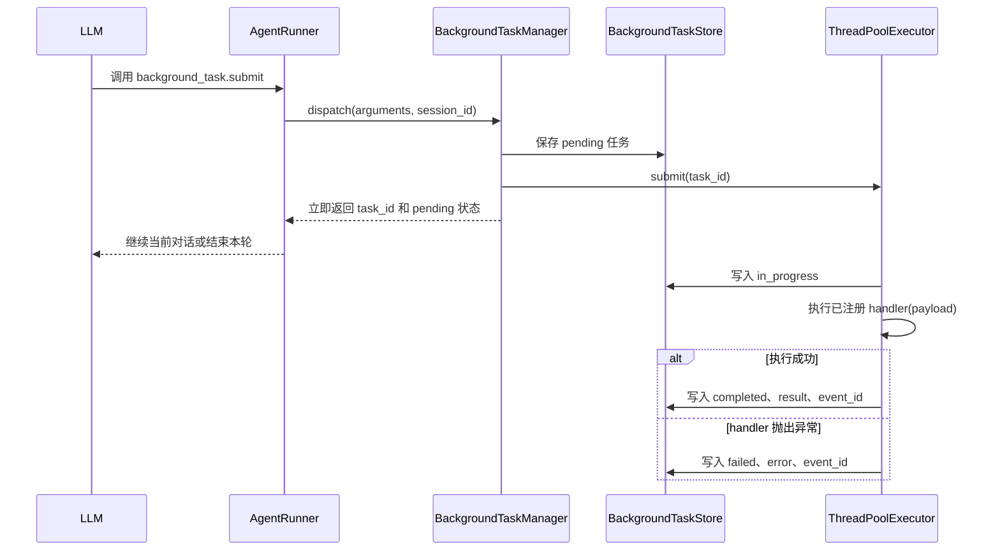
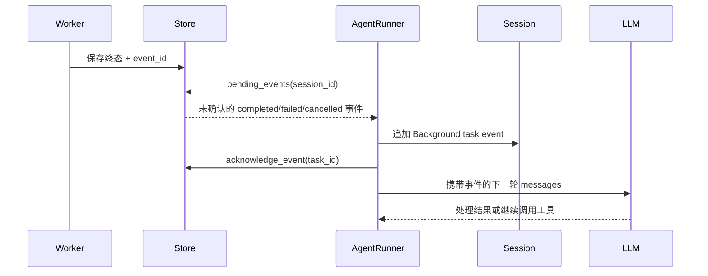

### provider.py
集成模型供应商。
初始化一个provider类，后续可以从中拿取到供应商的`base_url`和所提供的`model` name.

### tools
开发一个新工具基本分 4 步：
- 定义参数模型 `XxxArgs(BaseModel)`
- 定义工具类 `XxxTool(BaseTool[XxxArgs])`
- 在工具类里绑定 `name / description / args_model`
- 在 `ToolSet` 里注册这个工具

## Memory

Memory 用于跨轮次保存用户偏好、反馈、项目事实和外部引用。它由三部分组成：

- `main.py`：在每次用户请求开始时装配 Memory 上下文，并在本轮结束后提交后台维护任务。
- `src/runtime/memory_worker.py`：负责异步调度提取和整理，不阻塞 Agent 主循环。
- `src/infrastructure/memory.py`：负责 Memory 的检索、LLM side-query、提取、合并和文件持久化。

### 存储格式

Memory 保存在当前工作区的 `.swe-agent/memory/`：

```text
.swe-agent/memory/
├── MEMORY.md                  # name + description 索引
├── user-preference-tabs.md    # 单条 Memory
└── project-language.md
```

每条 Memory 是带 YAML frontmatter 的 Markdown 文件：

```markdown
---
name: user-preference-tabs
description: User prefers tabs for indentation
type: user
---

User prefers using tabs, not spaces, for indentation.
```

支持的 `type` 为：

- `user`：用户偏好。
- `feedback`：用户对 Agent 工作方式的指导或纠正。
- `project`：项目事实、约束和约定。
- `reference`：外部资料或引用位置。

`MemoryStore` 由 `main.py` 使用工作区、模型客户端和模型名称构造：

```python
memory_store = MemoryStore(
    workdir,
    client=provider.client,
    model=MODEL,
)
```

工作区路径由应用入口决定，Infrastructure 层不读取 `main.py` 的全局变量。

### 每轮开始：加载 Memory

Memory 通过两条路径进入当前轮上下文。

#### 路径一：索引常驻 SYSTEM

每次收到普通用户请求后，`main.py` 调用 `build_system_prompt()`：

1. 读取 `.swe-agent/memory/MEMORY.md`。
2. 将完整的 Memory 索引追加到 `Persistent memory index` 段落。
3. 将生成的 SYSTEM 传给本轮 `AgentRunner.run()`。

一次 `AgentRunner.run()` 内可能有多次模型和工具迭代，但它们复用同一个 SYSTEM。Memory 提取和整理只在整轮结束后触发，因此同一轮内不重复读取索引或重建 SYSTEM。

#### 路径二：相关 Memory 按需注入

`load_memories(session.history)` 在本轮 Agent 执行前加载相关 Memory：

1. `list_memory_files()` 只收集每条 Memory 的 `filename`、`name` 和 `description` 作为候选目录。
2. 最近对话截取最后 4,000 个字符，与候选目录一起发送给 LLM side-query。
3. side-query 只允许返回候选目录中的精确文件名，最多选择 5 条。
4. `load_memories()` 读取选中文件的正文，并渲染为 `<memory>` 块。
5. `main.py` 将这些块追加到当前轮的 `turn_system_prompt`，不写回 `session.history`。

如果 API 请求失败、响应为空、JSON 无法解析，或者 LLM 没有返回有效文件名，`select_relevant_memories()` 会自动降级为本地关键词匹配。关键词只匹配 Memory 的 `name + description`，名称命中的权重高于描述。

### 每轮结束：异步提取和整理

本轮 `AgentRunner.run()` 返回后，`main.py` 调用：

```python
memory_worker.submit(session.history)
```

`MemoryWorker.submit()` 会先深拷贝消息快照，然后把任务提交到单线程 `ThreadPoolExecutor`。主线程不等待任务结果，立即回到输入提示，因此用户可以继续提交下一条指令。

后台任务固定按以下顺序执行：

1. `extract_memories(messages)` 提取新 Memory。
2. `consolidate_memories()` 在达到阈值时合并重复、冲突或过期 Memory。

单线程队列保证不同轮次的后台任务串行执行，避免多个任务同时修改 Memory 目录。后台维护异常会被限制在 `MemoryWorker` 内，不会中断 Agent 主循环；失败的整理可以在后续轮次重试。



### 新 Memory 提取

`extract_memories()` 将最近对话和现有 Memory 的名称、描述发给 LLM，要求返回 JSON 数组：

```json
[
  {
    "name": "user-preference-tabs",
    "type": "user",
    "description": "User prefers tabs for indentation",
    "body": "Always use tabs when writing or editing files."
  }
]
```

写入前会校验必填字段和 Memory 类型，并跳过已有的同名 Memory。有效记录通过 `MemoryStore.write()` 写入独立 Markdown 文件，随后重建 `MEMORY.md`。

### Memory 整理

当 Memory 文件数量达到 `CONSOLIDATE_THRESHOLD`（当前为 10）时，`consolidate_memories()` 调用 LLM 检查重复、冲突和过期记录。LLM 返回：

```json
{
  "memories": [
    {
      "name": "coding-style",
      "type": "user",
      "description": "Preferred coding style",
      "body": "Use tabs consistently."
    }
  ],
  "remove": [
    "style-tabs.md",
    "style-spaces.md"
  ]
}
```

整理过程先写入合并后的 Memory，再删除 `remove` 中明确列出的源文件。删除范围被限制为当前 Memory 目录中已存在的文件，并且不会删除刚写入的目标文件。完成后重新生成 `MEMORY.md`。

### 一致性和失败边界

- Memory 文件和 `MEMORY.md` 使用同目录临时文件加原子替换写入，主线程不会读到半写入内容。
- side-query 失败只影响相关 Memory 的精确度，会降级为关键词匹配。
- 后台提取或整理失败不会影响当前回答或下一轮用户输入。
- `MemoryWorker` 只有一个工作线程，保证提取、整理和文件删除按轮次顺序执行。
- `/clear` 等 slash command 不会触发 Memory 提取；只有执行过 `AgentRunner.run()` 的普通用户请求会在结束时提交后台任务。

## Task 系统

Task 系统用于把“任务记录管理”和“慢任务执行”分开：

- `task_manager` 负责快速、同步的任务管理操作，例如创建任务、查询任务、领取任务和完成任务。
- `background_task` 负责提交可能阻塞主循环的慢操作，例如模型调用、批量处理、长时间 I/O 或子代理任务。

这里的 `Task` 是任务记录和依赖关系，`BackgroundTask` 是带有执行处理器的异步任务。两者使用相同的任务 ID 格式，但保存在不同目录中，不直接共享状态文件。

### 代码结构

```text
src/tools/task/
├── task.py              # Task、TaskArgs、TaskManager
├── background_task.py   # BackgroundTask、BackgroundTaskManager、线程池 worker
└── store.py             # 原子 JSON 写入和线程安全文件存储
```

工具注册在 `src/tools/toolset.py`：

```text
ToolSet
├── task_manager
└── background_task
```

`AgentRunner` 通过 `ToolSet.background_task_manager` 访问后台任务管理器，并在每次模型请求前检查完成事件。

### 快速任务模型

快速任务的数据结构如下：

```python
Task(
    id="task_<32 位小写十六进制字符>",
    subject="任务标题",
    description="任务描述",
    status="pending | in_progress | completed",
    owner=None,
    blockedBy=[],
)
```

任务 ID 使用 UUID4 的随机部分生成：

```text
task_ + uuid4().hex
```

这种 ID 具有较低的碰撞概率，并且可以安全地作为文件名。它不表达创建时间，因此列表排序是字典序，而不是创建时间顺序。

快速任务的工作流为：



`blockedBy` 中的每个任务 ID 都必须合法，并且只有所有依赖任务为 `completed` 时，当前任务才能被领取。当前实现会对 `blockedBy` 去重，但不会自动创建不存在的依赖任务。

### 后台任务模型

后台任务除了任务描述，还保存执行器信息和结果：

```python
BackgroundTask(
    id="task_<32 位小写十六进制字符>",
    subject="慢任务标题",
    description="慢任务描述",
    handler="registered_handler_name",
    payload={},
    session_id="所属会话 ID",
    status="pending | in_progress | completed | failed | cancelled",
    result=None,
    error=None,
    event_id=None,
    created_at=...,
    started_at=None,
    finished_at=None,
    acknowledged_at=None,
)
```

`handler` 保存的是处理器名称，不保存 Python callable。处理器需要由宿主程序注册：

```python
manager = ToolSet().background_task_manager
manager.register_handler(
    "slow_operation",
    lambda payload: do_slow_operation(payload),
)
```

这样任务文件中只保存 JSON 可序列化的 `payload`，避免把不可持久化的函数对象写入磁盘。默认 `ToolSet` 会注册 `background_task`，但默认没有业务 handler；实际应用需要根据自身能力显式注册 handler。

### 后台提交与执行流程



当前 worker 使用 `ThreadPoolExecutor`，默认最多 4 个工作线程。它适合网络请求、模型调用和文件 I/O 等 I/O 密集型操作；CPU 密集型任务如果需要并行，应在后续改用进程池或专用执行服务。

后台任务支持以下工具操作：

| action | 作用 | 是否需要 task |
| --- | --- | --- |
| `submit` | 创建并提交后台任务 | 是，需要 `subject`、`handler`、`payload` |
| `get` | 查询单个任务 | 是，需要 `id` |
| `list` | 查询全部后台任务 | 否 |
| `cancel` | 取消尚未开始的任务 | 是，需要 `id` |
| `retry` | 重新提交失败或已取消的任务 | 是，需要 `id` |

当前实现只允许取消 `pending` 任务。任务一旦进入 `in_progress`，不能被强制终止；如果需要可取消的慢操作，handler 应自行读取取消信号，这部分协议尚未加入当前版本。

### 完成事件注入

后台 worker 不直接修改 `Session.history`，而是把任务写成终态，并生成唯一的 `event_id`。完成状态包括：

```text
completed
failed
cancelled
```

每个后台任务提交时记录当前 `session_id`。`AgentRunner` 每轮开始、发起下一次模型请求之前执行以下流程：

1. 读取当前 session 尚未确认的终态后台任务。
2. 使用 `event_id` 去重。
3. 将任务结果封装为外部事件消息追加到 `session.history`。
4. 调用 `acknowledge_event()` 写入 `acknowledged_at`。
5. 将已注入的 event ID 保存到 `session.tool_state["background_task_event_ids"]`。

注入的消息形态如下：

```text
[Background task event]
A background task assigned to this session reached a terminal state.
{"task_id": "...", "subject": "...", "status": "completed", "result": "...", "error": null}
```

消息使用 `user` role，是因为它代表运行时产生的外部事件，而不是对历史 tool call 的重复响应。消息正文明确要求模型把它当作外部事件处理，而不是新的用户指令。



如果同一个任务被 `retry`，会清除旧的确认状态；新的终态会生成新的 `event_id`，因此重试结果不会因为旧任务 ID 已经注入过而被丢弃。

### AgentRunner 的结束行为

`AgentRunner.run()` 仍然是同步的一轮执行。后台任务提交后，如果模型没有继续调用工具，本轮会结束；如果此时仍有属于当前 session 的 `pending` 或 `in_progress` 任务，返回值会设置：

```python
AgentRunResult(
    ok=True,
    waiting_for_background=True,
)
```

这表示上层运行时需要保留该 session，并在后台任务完成后再次调用 `AgentRunner.run()`。下一次调用的第一步就是完成事件注入。

`BackgroundTaskManager` 也支持可选的 `on_task_finished` 回调。宿主程序可以使用这个回调唤醒对应的 session：

```text
worker 完成
    ↓
on_task_finished(task)
    ↓
宿主根据 task.session_id 找到 session
    ↓
重新调用 AgentRunner.run()
```

当前 Task 模块本身不会启动全局 session scheduler，也不会在后台线程中直接发起新的 LLM 请求。这样可以避免同一个 session 被多个线程同时修改历史或并发调用模型。

### 持久化与一致性

任务分别保存于当前工作区：

```text
.swe-agent/
├── tasks/
│   └── task_<id>.json
└── background_tasks/
    └── task_<id>.json
```

`JsonFileStore` 提供两项基础能力：

- 先写入随机临时文件，再使用 `os.replace()` 原子替换目标文件，避免读到半写入内容。
- 在同一个 manager 实例内使用 `RLock`，保护线程内的读写操作。

文件存储只保证单个 manager 实例内的线程安全。当前版本还没有跨进程锁或数据库事务，因此多个进程同时操作同一任务目录时，仍可能发生状态竞争。`TaskManager.claim_task()` 也还没有跨进程 compare-and-swap 保护。

### 快速任务与后台任务的选择

当前版本不额外调用一次 LLM 来判断快慢，而是通过工具能力和工具描述让 LLM 选择：

- 只涉及任务元数据、依赖检查和状态读写：使用 `task_manager`。
- 涉及模型调用、子代理、网络请求、轮询、批量处理或耗时不确定：使用 `background_task`。

后续如果需要统一入口，可以在工具层增加 `TaskRouter`，由 LLM 提供 `mode=auto/foreground/background`，再由运行时根据 handler 元数据和启发式规则做最终裁决。运行时规则应当覆盖明显的慢任务，不能完全依赖 LLM 对耗时的估计。

### 当前限制与后续演进

- handler 注册表目前只存在于进程内；进程重启后，已经提交但尚未完成的后台任务不会自动恢复执行。
- 目前使用线程池，尚未提供进度百分比、超时、强制取消和持久化重试次数。
- 完成事件通过扫描后台任务文件发现，任务规模较大时应改为持久化事件表或事件日志。
- `owner` 当前主要用于任务元数据记录，完成任务时还没有强制校验 owner。
- 如果需要多进程 worker、可靠恢复和严格任务领取语义，应迁移到带事务和锁机制的数据库或队列系统。
