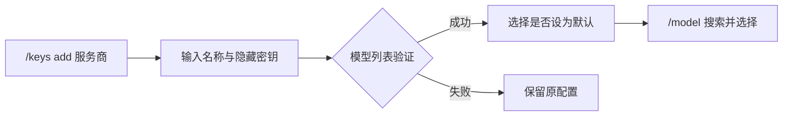
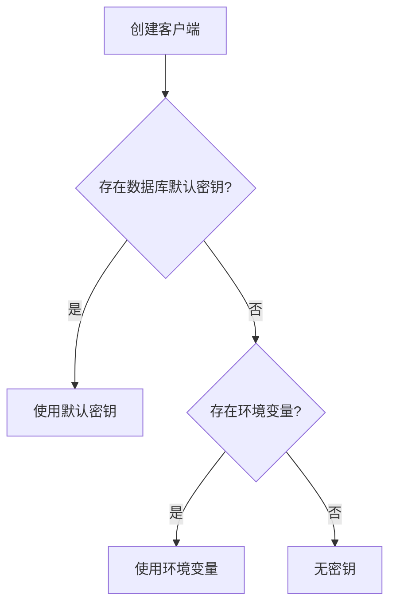

# 密钥与模型

## 配置流程



## 命令速查

`provider` 接受服务商 ID 或名称，省略时使用当前服务商。密钥 ID 从 `/keys list` 复制。

| 命令 | 行为 |
| --- | --- |
| `/keys` 或 `/keys list [provider]` | 列出 ID、名称、默认项、当前使用项、启用状态、最近验证 |
| `/keys add [provider]` | 命名、隐藏输入、验证，选择是否设为默认 |
| `/keys use <key-id>` | 验证后设为默认；当前服务商的客户端同步更新 |
| `/keys use env [provider]` | 验证环境变量后取消数据库默认项，保留已保存密钥 |
| `/keys test [key-id]` | 验证指定密钥；无 ID 时验证当前实际使用项，不切换配置 |
| `/keys remove <key-id>` | 确认后删除本地记录；当前项／默认项先选择并验证替代来源 |
| `/keys source [provider]` | 对比当前客户端来源与下次创建客户端的来源 |
| `/keys reset [provider]` | 验证并替换默认密钥，保留所选模型 |

`add` 选择不设为默认时仅保存；之后通过 `use` 激活。更新其他服务商的密钥不会切换当前服务商或模型。

## 凭据来源



- 启动不将环境变量复制到数据库，也不自动轮换其他已保存密钥。
- `source` 显示运行中的快照和下次解析来源，便于识别配置变化。
- `/model` 只读取凭据；缺少凭据时先用 `/keys add` 或 `/keys reset`。
- 删除本地记录不撤销服务商控制台上的密钥，也不删除 `.env`。
- 删除最后一个可用来源需要最终确认；确认后当前客户端停用 API 请求。

## 验证与排错

验证调用 models 接口，超时为 15 秒、不自动重试；不发送聊天请求，也不保证指定模型的聊天权限。

| 结果 | 含义与处理 |
| --- | --- |
| 成功 | 模型列表接口可访问 |
| HTTP 401 | 凭据被拒绝；检查／替换密钥，不能仅据此认定过期 |
| HTTP 403 | 访问被拒绝，检查服务商权限 |
| HTTP 429 | 请求受限，稍后重试 |
| 连接失败／超时 | 未验证；检查网络与 API 地址 |

```text
/keys source
/keys list
/keys test
/keys reset siliconflow
/model
```

验证失败或取消切换时保留原配置。命令输出不展示密钥内容；不要把明文密钥作为命令参数。
