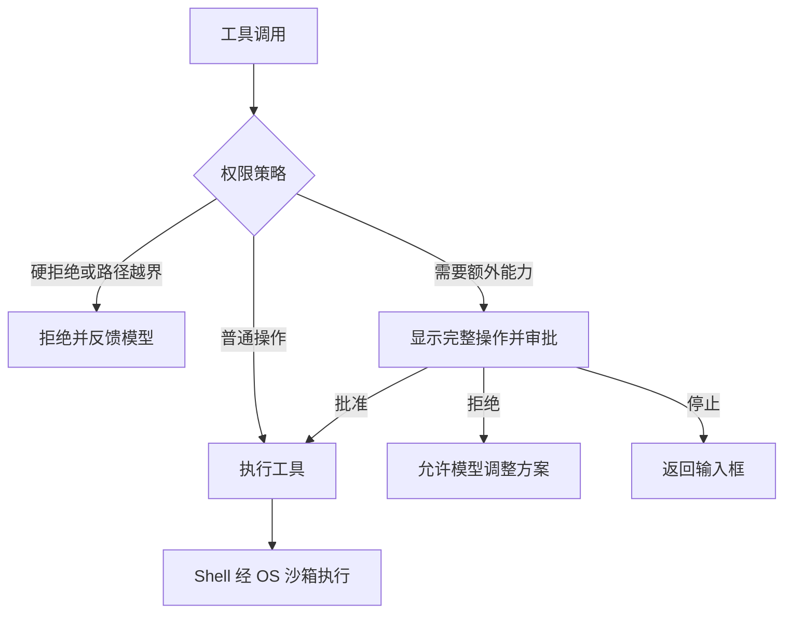

# 权限审批

## 执行路径

审批卡片包含完整操作、实际目录、来源、风险、全部所需能力和是否支持复用。

| 操作 | 策略 |
| --- | --- |
| workspace 内文件工具、可识别的普通命令／只读组合 | 通常直接执行 |
| 网络访问 | 请求 `sandbox.network` |
| 删除、Git reset/clean 等破坏性操作 | 请求 `workspace.destructive` |
| 脚本、解释器、重定向等难以静态判断的 Shell | 请求 `shell.opaque`，仅单次批准 |
| 未分类扩展工具 | 请求 `tool.<name>` |
| 硬拒绝命令、workspace 外路径 | 直接拒绝，批准不能绕过 |

同一操作需要的能力一起审批，例如“联网后删除”会同时展示网络与破坏性权限。具体分类以审批卡片为准。

## 前台选择

| 输入 | 效果 |
| --- | --- |
| `y` | 仅本次批准 |
| `t` | 本轮相同操作复用 |
| `a` | 当前已加载会话内相同操作复用 |
| `n` | 拒绝该操作，模型可以改用允许的方案 |
| `s` 或 Esc | 停止当前运行 |

不可复用的操作不提供 `t/a`。Windows／POSIX 交互终端均单键立即响应，无需回车；问题、选项和输入提示分行显示。非 TTY 使用整行输入，并明确提示按 Enter。未知答案不会批准。

**授权绑定完整命令、实际目录和全部能力；扩展工具还绑定完整参数。** 更换 URL、删除目标、目录或能力需要重新判断。旧命令前缀不再授予权限。

会话授权仅存内存；卸载、恢复会话或重启后失效，不生成永久放行规则。

## 后台请求与撤销

worker 不读取终端输入，在主输入框处理：

| 命令 | 用途 |
| --- | --- |
| `/permissions` | 查看待审批请求与完整详情 |
| `/permissions approve <id> [once\|turn\|session]` | 批准；默认 once |
| `/permissions deny <id> [feedback]` | 拒绝并反馈原因 |
| `/permissions stop <id>` | 停止对应运行 |
| `/permissions grants` | 查看当前会话授权及编号 |
| `/permissions revoke <number\|scope\|all>` | 撤销授权；编号以最新列表为准 |

普通拒绝后，同批后续工具会补齐跳过结果，模型可重新规划；本轮相同被拒操作不重复询问，累计三次拒绝后停止。停止／取消会结束当前运行并补齐工具消息。

## Shell 执行模式

| 启动参数 | 行为 |
| --- | --- |
| 不指定／`--execution-mode sandbox` | 默认使用 OS 沙箱；不可用时拒绝执行 |
| `--execution-mode host` | 显式宿主执行，每条 Shell 命令单次批准，不提供轮次／会话复用 |

宿主模式在启动、`/status`、前台审批卡片和后台 `/permissions` 中标明 **NO OS SANDBOX**。Windows 优先 pwsh，其次 Windows PowerShell；使用 `curl.exe` 避免 curl 别名，Windows PowerShell 5 不支持 `&&`。

宿主模式保留 cwd 检查、硬拒绝规则、环境清洗、私有临时目录、超时、取消和输出尾部限制；命令以当前用户身份执行，**文件和网络均不隔离**，cwd 检查不限制命令访问其他目录。模式只由本次启动参数决定，不随会话恢复。审批能力为 `host.execute`，识别到联网时另显示 `host.network`；这些是审批标记，不是 OS 网络限制。

默认沙箱后端：

| 平台 | 后端 |
| --- | --- |
| Linux | bubblewrap（`bwrap`） |
| macOS | `/usr/bin/sandbox-exec` |
| Windows／缺少可用后端 | 拒绝执行，不回退宿主 |

沙箱默认：workspace 可写、网络关闭、使用临时 HOME/TMP、清洗环境变量并限制敏感宿主目录。网络批准仅授予对应执行所需能力；超时终止进程组，输出保留尾部。

沙箱不提供文件回滚；风险分类仍含字符串规则。新增执行路径应复用 Runner 的权限检查，工具自身继续验证路径。

实现：`src/runtime/{permissions,approval,sandbox,agent_runner}.py`。验收见 [权限人工测试](permission-manual-tests.md)。

宿主执行器：`src/runtime/host_executor.py`。超时／停止时，Windows 使用系统 taskkill 尝试终止进程树，POSIX 终止进程组；已经产生的副作用不会回滚。
