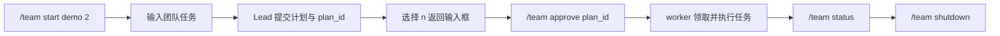

# Agent Teams

Lead 提出计划，用户批准后，worker 领取任务并运行独立 Agent Loop。

## 操作流程



| 命令 | 用途 |
| --- | --- |
| `/team start <team-id> [worker-count]` | 创建／恢复团队 |
| `/team approve <plan-id>` | 批准计划并启动任务 |
| `/team status` | 查看计划、成员、任务数量 |
| `/team shutdown` | 停止团队 |

计划输出包括目标、任务、依赖、负责人提示和 workspace 模式；出现 `Continue Agent Loop?` 时选 `n` 回主输入框审批，选 `y` 继续 Lead Loop。

## 执行边界

| 阶段／场景 | 行为 |
| --- | --- |
| 计划提出前 | Lead 先规划，不能先调用 workspace 工具 |
| 计划批准前 | 拦截写文件、写入型 Shell 和任务修改 |
| 计划批准后 | Lead 编排；worker 持有 active task 才能修改 workspace |
| 需要额外权限 | worker 等待；主输入框用 `/permissions` 处理 |
| 上下文回退 | 只回退自己的 history；文件、任务、消息与审批副作用保留 |

Shell 与前台使用同一沙箱和权限策略。脚本／解释器等可能要求单次批准，详见 [权限审批](PERMISSIONS.md)。

## workspace 与 worktree

```text
workspace_mode 默认      → 当前仓库目录
workspace_mode=worktree  → .swe-agent/teams/<team-id>/worktrees/<task-id>/
```

任务首次领取时创建 worktree；文件工具与 Shell 使用该任务绑定的 workspace。结果不自动合并或清理，交付时检查 diff 后处理。

## 保存与恢复

```text
.swe-agent/teams/<team-id>/
├── state.json
├── tasks.json
├── inbox/<agent-id>/
├── processing/<agent-id>/
├── processed/<agent-id>/
└── worktrees/<task-id>/
```

| 状态 | 恢复方式 |
| --- | --- |
| 已保存计划 | 使用相同 team ID 启动；未审批计划可继续用原 plan_id 批准 |
| 已批准团队 | 恢复任务板和消息，重新启动队友 |
| 遗留 processing 消息 | 启动时移回 inbox |
| 过期任务 claim | 回到 pending，可再次领取 |
| worker 的 Agent Session | 当前不跨进程恢复 |

任务板通过文件锁、claim_token 和租约协调领取；消息通过 processing／processed 阶段记录消费。具体文件操作仍受平台与文件系统限制。
