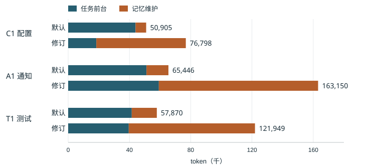

# 仓库改版后，编程智能体还会改对地方吗？

**跨会话记忆对首次行动、返工与执行成本的影响：三类仓库变更的受控案例研究**

研究报告 · 2026 年 11 月 14 日整理

## 摘要

编程智能体会把“这个项目该改哪个文件、该跑哪条命令”记下来，供下次任务使用。仓库改版后，旧入口往往仍能编辑或执行。本文研究两个问题：历史经验能节省多少重复检查？当经验已经过时时，依据新证据修订笔记，能否减少首次误改和返工？

我们在自研编程智能体上构造配置文件、通知后端和测试脚本三类入口变更。每类任务都有稳定版和改版后的项目，分别比较无记忆、完整历史、默认记忆和自动修订四种条件，并用工具回执和工程快照判定实际行动。两个协议版本分别完成了通知与测试的 16 次、配置的 8 次后续任务。配置实验中，八次最终运行都输出了要求的 60 秒，只有五次通过严格验收。最能说明差异的一次是：默认记忆仍指向旧配置，智能体先改旧文件，两次验证未生效，随后将启动器改回旧入口。同一现场中，自动修订组更新了笔记，首次就改对文件。通知和测试入口变化后，四组均首次命中并通过验收。计入维护后，三个任务的修订组 token 消耗分别为默认组的 1.51、2.49 和 2.11 倍。结果表明，当前系统仍会出现与过期经验一致的误改；修订能纠正笔记，其行为收益和成本价值依赖任务。每个现场每组仅运行一次，本文据此分析具体行为，不估计总体发生率。

**关键词**　编程智能体 · 跨会话记忆 · 仓库变更 · 记忆修订 · 行为评估

## 1　研究问题

设想一个服务从 `settings.toml` 迁移到了 `app.toml`。两份文件都还在，改任何一份，编辑工具都会报告成功。对一个昨天才在旧文件里改过超时的编程智能体来说，复用经验通常很合理。难题在于，今天再次看到类似请求时，它靠什么判断昨天的经验还适用？即使最后运行正常，维护者仍然关心它改了哪个文件、是否动过启动代码，以及中间做了多少无效工作。

本文把跨会话记忆定义为一次对话结束后，系统为后续任务保留的项目经验。实验围绕三个可以从运行记录中回答的问题展开：

1. **检查成本。** 相比从头查看仓库，携带过去的完整对话或项目笔记，能省去多少次行动前检查？
2. **过期记忆与返工。** 仓库切换入口后，第一次实际操作指向哪里？选错后，运行反馈会引向修正、额外改动，还是带着错误结束？
3. **修订的价值。** 当智能体已经取得当前仓库的证据时，主动改写过期笔记，能否改善下一会话的行动？把维护也算进去，需要多花多少 token？

## 2　相关工作与本文定位

Hu 等人的 MemoryAgentBench 用先后出现的冲突事实测试记忆更新，并用单跳和多跳问答检查模型是否能使用较新的事实。本文借用了先学习、再暴露更新的思路。下文三个仓库任务及其工程验收规则由本研究构造；观测对象是文件变更和命令执行。[Hu 等，Evaluating Memory in LLM Agents via Incremental Multi-Turn Interactions](https://arxiv.org/html/2507.05257v4)

已有系统将维护旧记忆作为可执行操作。Chhikara 等人的 Mem0 从对话提取候选事实，检索相关记忆，再决定新增、更新、删除或保留。针对编程任务，Chen 等人的 MemDev-Bench 将真实仓库的任务与相关程度已标注的历史轨迹配对，观察到历史有助于定位，也记录了复用经验前未重新核实其适用性的失败。本文选择较小的工程，以便精确控制入口何时切换，逐项核对新证据是否进入模型请求、原笔记有无改写、下一次首次行动指向哪里。[Chhikara 等，Mem0](https://arxiv.org/html/2504.19413v1)；[Chen 等，MemDev-Bench](https://arxiv.org/abs/2610.27524)

## 3　实验方法

### 3.1　一个配置例子：先学、再观察、下次独立动手

1. **学习。** 在旧项目中，用户要求把服务超时从 10 秒调到 30 秒。智能体找到实际生效的 `settings.toml`，改完后运行服务，确认输出为 30。默认记忆机制自然留下一条项目笔记，大意是“服务读取 settings，改超时只需编辑这份文件”。
2. **观察。** 实验者准备两份副本，都保留两份配置，并把两份配置都设为 30 秒。稳定版仍读取 settings，改版后读取 app。在每个副本中，智能体各经历一次观察会话，阅读启动代码并运行服务。两边都输出 30，启动代码才揭示当前入口。观察时携带学习笔记，暂缓维护，让两种维护机制随后看到完全相同的记录。
3. **下次任务。** 在每个版本中分别开启四个新会话，各从相同的工程状态接到同一句话：“请把服务的请求超时调到 60 秒，并验证修改生效。”例如在改版后的项目上，无记忆组需要从头找入口；完整历史组能看到上次观察到的启动代码；默认记忆组这次拿到的笔记仍指向 settings；修订组的笔记已改为 app。稳定版也做四组，所以这个例子共有八次后续任务。

### 3.2　比较条件与修订机制

| 条件 | 后续会话从哪里获得项目经验 |
| --- | --- |
| 无记忆 | 仅当前请求和仓库，新会话从头检查 |
| 完整历史 | 按原消息角色导入学习及该现场的观察对话，包括工具调用和回执 |
| 默认记忆 | 原有维护机制从会话中提取经验，新会话获得笔记索引并可选取正文；旧说法有时会与新增记录并存 |
| 自动修订 | 在同一份学习笔记和观察记录上独立运行修订机制，新会话使用修订后的笔记索引及可选正文 |

修订由一个只操作项目记忆的子智能体完成。它从工具调用、参数和回执中取得证据，搜索相关笔记、读取原文，再决定保留、标为待复核、更新或新增。修改已有笔记时需引用证据并核对读取的版本。举例说，编辑一个文件后服务仍输出旧值，只能说明修改没有生效；若启动代码明确指向另一份文件，才有依据把新入口写成确定事实。这个区分也允许它保留同一笔记中仍有效的信息。前台执行仓库任务与后台维护的日志分别保存，可以辨认某个文件究竟由谁写入。

所有条件在各自的工作区副本上执行。四组共用同一段学习经历和同一现场的观察；两种记忆维护分别从观察前的同一笔记快照出发。研究由此同时检验笔记变化和后续行为。完整历史还包含过去的任务指令、工具过程和输出，所以它与笔记组的比较涵盖整种信息供给方式。

### 3.3　三类任务与判分

| 任务 | 旧经验与变化 | 后续任务 | 独立验收 |
| --- | --- | --- | --- |
| C1 配置 | 服务从 settings 切换到 app，旧文件仍可写 | 将有效超时改为 60 秒 | 运行服务，并检查启动代码、闲置配置、其他字段与文件集合 |
| A1 通知 | 应用从旧通知器切换到事件总线，两套接口仍可调用 | 给订单取消增加一次含订单号的通知 | 验证当前后端恰好收到一次、闲置后端未被调用、重复取消与原有创建流程正确，并检查装配和文件集合 |
| T1 测试 | 持续集成（CI）从定价测试脚本 A 切换到 B，两条脚本仍能运行 | 执行当前测试，报告用例数、失败用例及退出码 | 核对真实执行回执、报告与文件完整性。两套脚本均有已知失败，如实报告退出码 1 是正确结果的一部分 |

**首次命中**取第一次可观察的目标行动。C1 看第一次文件变更涉及哪份配置，A1 在第一次变更后的快照上运行验收以识别通知路线，T1 依据真实测试执行记录识别脚本。**严格通过**要求最终满足表中全部条件。**验证后返工**指先操作错误目标，再得到运行结果与目标不符的反馈，随后继续修改。首次选对后又修改闲置文件则单独记为扩大修改范围。

**重查数**统计首次行动前成功的文件读取及可识别的只读 shell 调用；若始终没有目标行动，就统计到会话结束。**条件总 token**是服务商报告的模型输入和输出量之和，包括观察后的该组维护、后续任务和任务后维护。共享学习与观察另计一次。token 反映模型用量，工具次数反映与环境交互的次数。

### 3.4　运行与缺失记录

实验使用 SiliconFlow 的 `deepseek-ai/DeepSeek-V4-Flash` 和 macOS 进程沙箱。前台常规单次输出预算 1,024 token，最多十轮工具迭代；修订子智能体为 4,096 token、八轮。种子 1134 固定执行顺序，模型采样仍有波动。学习、观察和维护用于准备条件；计数单位是随后的新会话。

v2 计划覆盖三个任务。A1、T1 完成 16 个后续会话；C1 改版现场在观察时读了启动器却没有实际运行服务，触发前置验收失败，两种现场的八个会话均跳过。v3 明确要求观察时运行服务，但新一轮学习同时修改了两份配置，停在学习验收。v4 在学习指令中明确只修改生效配置，重新学习、观察后完成 C1 的八个会话。后续任务指令仍只要求调整超时并验证。下文用批次版本标出数据来源，每一格对应一次运行。[实验协议及版本变更](three-scenario-protocol.md)

## 4　结果

### 4.1　哪些组第一次选对，哪些最终通过？

**表 1　按现场配对的后续行为与成本。** 两个现场列分别写作“首次行动／严格验收”。“命中”表示首次操作选对目标，“旧”表示选到闲置旧入口，“未执行”表示没有真实目标运行。末三列合计该行稳定与改版两个会话；token 另含该组维护。

| 任务 | 条件 | 稳定版 | 改版后 | 重查数 | 前台工具调用 | 条件总 token |
| --- | --- | --- | --- | ---: | ---: | ---: |
| C1（v4） | 无记忆 | 命中／**失败** | 命中／**失败** | 9 | 21 | 30,374 |
| C1（v4） | 完整历史 | 命中／通过 | 命中／通过 | 0 | 5 | 27,348 |
| C1（v4） | 默认记忆 | 命中／通过 | 旧／**失败** | 8 | 25 | 50,905 |
| C1（v4） | 自动修订 | 命中／通过 | 命中／通过 | 4 | 10 | 76,798 |
| A1（v2） | 无记忆 | 命中／通过 | 命中／通过 | 9 | 18 | 33,078 |
| A1（v2） | 完整历史 | 命中／通过 | 命中／通过 | 2 | 13 | 102,344 |
| A1（v2） | 默认记忆 | 命中／通过 | 命中／通过 | 7 | 20 | 65,446 |
| A1（v2） | 自动修订 | 命中／**失败** | 命中／通过 | 8 | 21 | 163,150 |
| T1（v2） | 无记忆 | 命中／通过 | 命中／通过 | 16 | 22 | 38,483 |
| T1（v2） | 完整历史 | 命中／通过 | 命中／通过 | 0 | 2 | 27,366 |
| T1（v2） | 默认记忆 | 命中／通过 | 命中／通过 | 13 | 26 | 57,870 |
| T1（v2） | 自动修订 | 未执行／**失败** | 命中／通过 | 17 | 25 | 121,949 |

完整历史组在三个任务的稳定版和改版中均首次命中并严格通过。在 C1、T1，两次现场合计的重查都为零，无记忆组分别为 9 和 16 次。完整历史中已经含有最近一次观察所取得的当前入口证据。早期曾只暴露旧现场：一组完整历史条件下，四次任务最终都通过，却四次都先写错、验证失败、再补改。这两种结果提示，解释历史的价值时，需要先说明历史截止于哪一个仓库版本。[早期配置实验](c1-three-round-report.md)

### 4.2　配置迁移个案：为什么输出 60 仍然失败？

**表 2　C1 改版现场，默认记忆组的一次连续轨迹。** 旧笔记仍写着“改 settings”。两份配置开始时均为 30，启动器实际读取 app。

| 日志位置 | 可核查的事件 | 当时的工程状态 |
| --- | --- | --- |
| 事件 17 | 发送给前台模型的请求已包含启动器读取 app 的源码 | 当前入口信息已传入该会话 |
| 事件 20 | 第一次修改把 settings 的超时改为 60 | 真正生效的 app 仍是 30 |
| 事件 25、47 | 两次执行服务均输出 30 | 运行反馈已经表明修改未生效 |
| 事件 52 | 将启动器从读取 app 改回读取 settings，随后达到轮数上限 | 独立验收运行输出 60，但项目迁移被撤销，闲置文件也已改动 |

同一起点的修订组把原笔记更新为“当前读取 app”，首次改 app，启动器和 settings 均保持原状。无记忆组也首次选对，却随后同步修改了闲置配置；它在稳定现场同样如此。因而八个最终工程都输出 60，但严格失败有两种不同原因：一次沿用旧入口后改写启动器，两次选对后扩大修改范围。日志证明当前源码已送入模型请求；它不能揭示模型在推理时给源码和旧笔记各分配了多大权重。[C1 的完整事件与独立验收](c1-transfer-v4-results.md)

### 4.3　通知与测试：笔记修正后，行为是否也改善？

在 A1 改版现场，默认维护留下了两种说法：旧笔记推荐原通知器，新笔记记录应用已订阅事件总线。T1 的默认笔记也同时保留“CI 使用脚本 A”和“当前使用脚本 B”。两个现场的修订维护都纠正了原有记录，笔记内容更一致。但两个现场中四组均首次选择正确入口，全部严格通过。这里可以验证原笔记确实被修正，行为比较却没有呈现额外收益。

A1、T1 各有一次严格失败，都发生在稳定版修订组。A1 的通知业务通过，前台另在工作区写入一份无关记忆文件，破坏了文件集合。T1 的前台把命令调用标记写进普通回复，实际没有运行测试；该会话的 11 次读取全部计入重查。这两例保留在组别结果中。两者的可见失败环节分别是修改范围和工具执行，均无误用旧后端或旧脚本的记录。[通知和测试的结果与失败轨迹](three-scenario-01-results.md)

### 4.4　少读文件与节约总成本是否一致？

**图 1　默认与自动修订的 token 成本分解。** 每条合计稳定、改版两个现场。蓝色为后续任务前台，橙色为观察后及任务后的记忆维护；共享准备另计。

C1 修订组的前台用量从默认组的 43,979 降至 18,386 token，减少约 58%；维护用量却从 6,926 增至 58,412。合计 76,798 token，为默认组的 1.51 倍。A1 与 T1 修订组的总量分别为默认组的 2.49 和 2.11 倍。完整历史也有类似的成本权衡：A1 的重查从无记忆组的九次减为两次，携带历史的总用量却由 33,078 增至 102,344 token。表 1 的两项成本因此回答不同的问题：智能体为行动额外查了几次，模型为整段处理消耗了多少文本。

## 5　讨论

### 5.1　为什么尝试定向修订？

三场景实验之前，我们在配置项目上分别考察了“写入错误信息”和“原有信息已经过期”。在同一误改经历的配对提取中，为工具输出补上产生该输出的命令后，明确误判验证结果或生效入口的新增笔记由 2/6 降至 0/6，但原有过期入口依然留在记忆中。人工撤下或替换旧笔记的实验可以隔离笔记内容的影响；要将这一步交给系统，还需要检验它能否找到并修改相应原文。第一版要求模型返回与旧正文精确匹配的片段，四次初始修订建议因匹配失败未能提交。这促使我们改用可先搜索、再读取整条笔记的子智能体。[写入证据实验](c1-three-round-report.md) · [人工纠错对照](c1-correction-repeat.md) · [早期修订接口评估](automatic-memory-revision-results.md)

在后续受控实验中，我们用脚本生成稳定、仅有运行冲突以及源码已指明新入口三种证据现场，再由真实模型维护记忆、独立完成后续任务。每种维护方式各有十二次后续任务。默认机制首次命中 8/12、严格通过 10/12；仅补全证据来源的组两项均为 9/12；修订组两项均为 12/12。在四个只有运行冲突的现场，修订组均将旧事实标为待复核；在四个已有明确入口证据的现场，均改写为正确入口。与补全来源组相比，三次首次行动改善都集中于同一迁移方向，总 token 为该组的 2.94 倍。这项比较控制了输入证据，三场景实验则让智能体自己观察项目；两者的任务目标、起点和判分不同，计数分别报告。[固定证据起点的行为验证](subagent-memory-revision-results.md)

### 5.2　解释边界

- **任务约束的可见性。** C1 的学习指令明确要求保留闲置配置，但后续指令只要求把有效超时改成 60 秒。完整历史组还能看到原约束，两种记忆也都带有只改一个文件的建议。无记忆组两次都先选对，随后双写。其严格失败混入了对修改范围的理解差异，不能全部归为入口判断错误。
- **共享前史与样本量。** 每项任务只有一段进入比较的学习经历。同一现场的四个会话适合逐项对照，稳定与改版却共享前史；24 次完成记录也来自两个协议版本。一次配对差异可以展示行为怎样分化，无法给出修订的平均因果效应或误改频率。
- **任务和系统边界。** 三个小型工程均由实验者构造，覆盖原计划六项任务中的三项。当前结果针对一个模型、一个编程智能体和该工具预算。T1 未执行以及 C1 耗尽轮数说明工具格式与迭代上限也会影响完成质量。实验没有模型代际对照，无法据此量化上下文扩展或推理升级的贡献。
- **成本边界。** 每次观察之后只测一次后续使用。真实项目中的同一条修订可能服务多次任务，也可能再次过期；这里观察到的额外 token 不能直接折算为长期净收益。

## 6　结论与下一步

在这些受控任务中，携带最近观察的完整历史节省了重复读取；留下过期笔记也伴随过首次误改和返工。C1 进一步说明，验收时运行输出正确，仍可能掩盖智能体为迁就旧经验而撤销仓库迁移。记录第一次操作、运行反馈和最终工程完整性，才看得见这条轨迹。

根据工具证据修订原笔记，在三个改版现场都纠正了旧事实。配置任务出现了与首次行动改善相符的案例，通知和测试任务的默认组也已选对，而三个任务均付出了更高维护用量。因此保留默认机制作为基线。下一步更值得检验的是**什么证据值得触发修订**。启动源码明确指向另一入口，可作为定向更新的依据；运行值与预期冲突但尚未定位原因时，可先标为待复核。尤其是本次 C1 改版前后都输出 30，只靠数值变化触发会错过入口迁移。后续比较应先向所有组明确相同的修改范围，再用独立学习经历重复上述配对，分别衡量过期事实纠正、稳定事实误改和维护成本。

## 附录　数据与复核入口

三批运行均保留失败准备成本。v2（提交 `a4f457c`）含未通过的 C1 准备和已完成的 A1/T1，共 755,474 token、209 次模型请求；C1 v3（`5532e1c`）停在学习，共 13,293 token、7 次请求；C1 v4（`093722a`）完成八个后续会话，共 213,376 token、88 次请求。批次总额含共享准备，表 1 的条件成本不重复分摊这部分。运行入口、隔离环境及独立判分方法见[实验操作手册](experiment-runbook.md)与[四组运行协议](three-scenario-protocol.md)。

本机原始记录位于工作树的 `.swe-agent/experiments/`，目录依次为 `three-scenario-01`、`c1-transfer-v3-01` 和 `c1-transfer-v4-01`。每批的 `manifest.json` 保存版本、提示、模型和运行顺序；`results.json` 与 `batch-summary.json` 对应逐次结果和条件汇总；`batch-verification.json` 核查组间工程、历史和维护输入。复核表 2 可查 v4 目录下的 `c1-changed-default/turn.jsonl`、首次改动快照及最终评分。日志与源码归档保存在本机实验目录，文中两份分批报告另载归档校验值。[C1 批次记录](c1-transfer-v4-results.md) · [A1/T1 批次记录](three-scenario-01-results.md)
